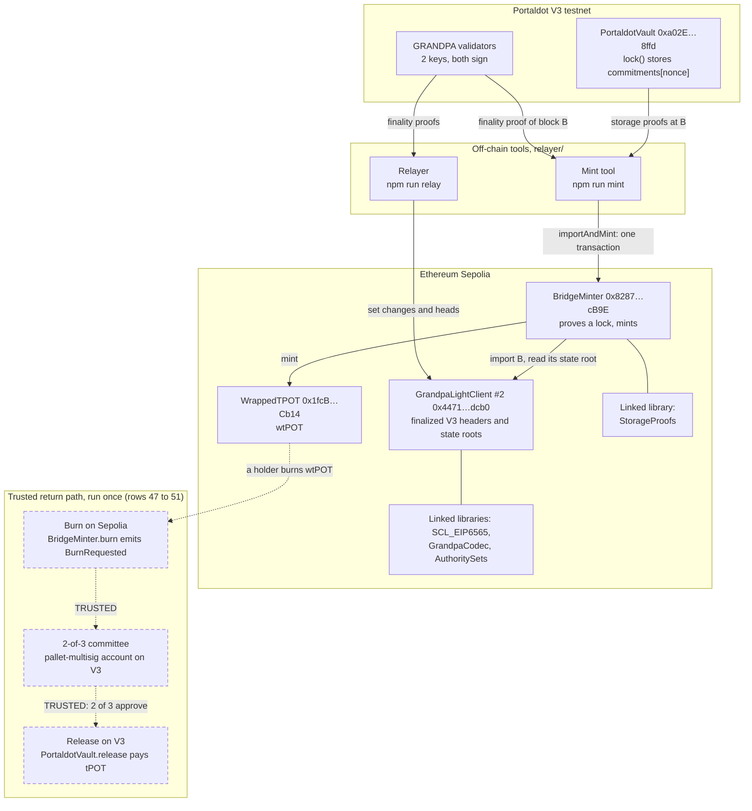
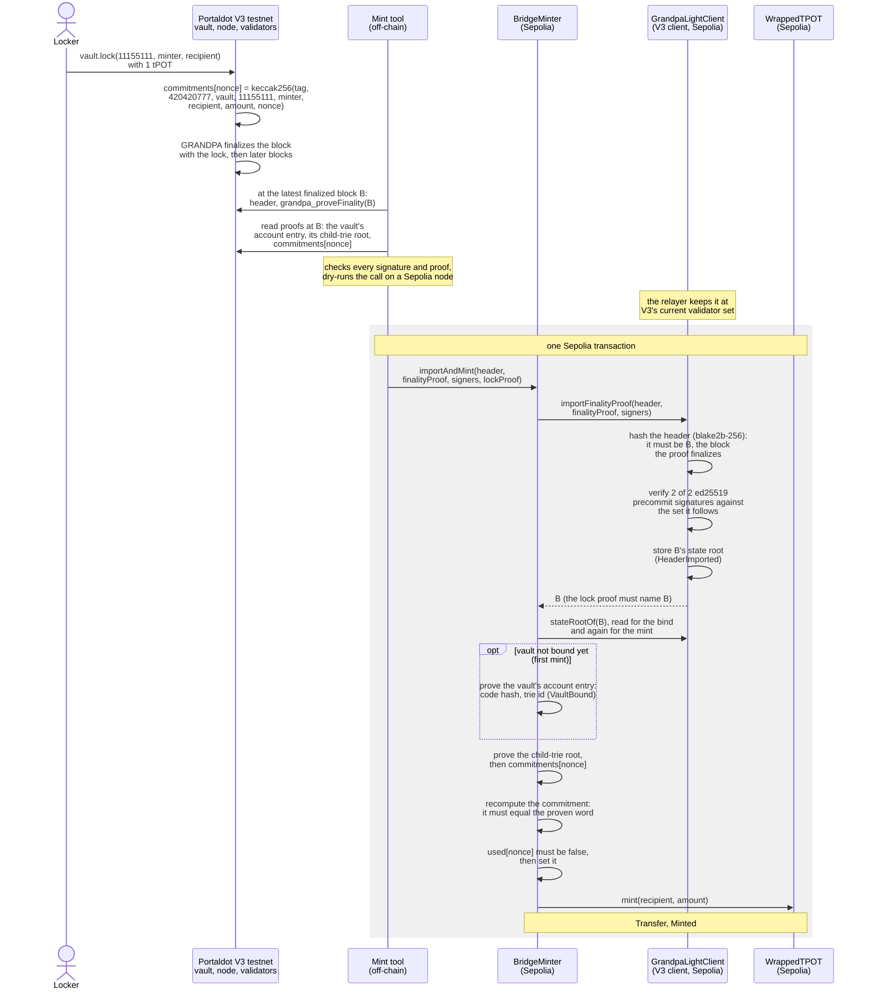

# Bridge Zero

A Portaldot light client on Ethereum. Solidity contracts check Portaldot's GRANDPA
finality (the validators' signatures) and Substrate storage proofs, so an EVM
contract can use Portaldot state without a trusted relayer: trust rests on the
Portaldot validator set.

**Live page: [jonathan-moore58.github.io/bridge-zero](https://jonathan-moore58.github.io/bridge-zero/)**. It reads both light clients, the
vault and the bridge from the chains as you watch, and its "Check it live" buttons send the
tampered mints to BridgeMinter as read-only calls, which it refuses. It has no wallet and signs
nothing.

Built for the Portaldot Hacker House 2026, Multi-Chain & Cross-Chain Infra track.
Development runs from Oct 14 to Nov 6, 2026; this repository starts on Oct 14.

## What it does

`GrandpaLightClient` runs on Ethereum Sepolia and follows the finality of a Portaldot chain: it
accepts a block header only with valid signatures from more than two thirds of the chain's GRANDPA
validators, checked in Solidity, and then holds that block's state root, against which contracts
check Substrate storage proofs. The bridge is built on it: tPOT locked in a vault on the Portaldot
V3 testnet becomes wtPOT on Sepolia in one transaction that verifies V3's finality, proves the lock
from the vault's storage, and mints. No trusted relayer: anyone can bring the proofs, and the
contracts check them. What is trusted is the Portaldot validator set, each chain's sudo key and
each light client's admin ([Trusted](#how-it-works)); the way back (burn wtPOT on Sepolia, release
tPOT on V3) is trusted too, a 2-of-3 committee, and ran on Oct 20 after Sepolia's finality (rows 47
to 51) and on Oct 24 in fast mode, 84 seconds from the burn's block to the release's (rows 56 to 58).

So Bridge Zero is an asset bridge and a data bridge. The asset bridge moves tPOT to Sepolia as
wtPOT and back. The data bridge is the light client with the proof libraries: any EVM contract can
use them to read proven Portaldot state, as ProvenBalance (an account's balance) and BridgeMinter
(a lock in the vault's storage) do, and they are a building block for iBridge. Today the bridge
connects the Portaldot V3 testnet and Ethereum Sepolia. The [roadmap](#roadmap) plans a liquidity
engine for transfers that settle in seconds and the same contracts on more EVM chains that have the
BLAKE2F precompile.

## Live on testnets

| | Where | What it proves |
|---|---|---|
| **Lock 0 minted** (row 32) | Sepolia transaction [`0x91714c84…`](https://sepolia.etherscan.io/tx/0x91714c8422a7058c161f5592ff7c59eb62399bc99d5f02d6a9ebc1506c955cba) | One transaction verified V3 block #108,424 with both V3 validators' signatures, bound the vault, proved lock 0's commitment from the vault's storage and minted 1 wtPOT. Its Logs tab lists `HeaderImported`, `VaultBound`, `Transfer` and `Minted`. |
| **Lock to mint in 48 seconds** (rows 54 and 55) | Sepolia transaction [`0xb9134dd7…`](https://sepolia.etherscan.io/tx/0xb9134dd793b84ff53375cd6b5ec8fb51940fea0a5cce2b5924f674b530d7f943); the lock in V3 block [#118,636](https://node-console.portaldot.dev/?rpc=wss%3A%2F%2Ftest-node-v3.portaldot.dev#/explorer/query/118636) | Lock 1, Oct 20: 1 tPOT locked on V3 and minted on Sepolia, the mint's block 36 seconds after the lock's by the block timestamps; 48 seconds from sending the lock to the mint's receipt with the tools' own checks. |
| **Auto-mint: the user signs only the lock** (rows 83 to 85) | Sepolia transaction [`0xb6164465…`](https://sepolia.etherscan.io/tx/0xb616446586c8aa0b23658fa5c58694682734fc1b0d1237f0e4e7818d4b4787a3); the lock in V3 block [#219,589](https://node-console.portaldot.dev/?rpc=wss%3A%2F%2Ftest-node-v3.portaldot.dev#/explorer/query/219589) | Lock 2, Oct 27: 0.01 tPOT locked on V3. The operator's auto-mint saw the lock, waited for V3's finality and a 90-second grace, and sent the mint on Sepolia from a key of its own, which paid the gas: the mint's block 144 seconds after the lock's. The user sent nothing for the mint, and the minter paid only the address the lock commits to. |
| **Auto-mint for a lock from a Portaldot account** (rows 86 and 87) | Sepolia transaction [`0xb6e2a07b…`](https://sepolia.etherscan.io/tx/0xb6e2a07b2a60cde09552b347c47674ab1979429963f7fdeb659bc4eaacf36f56); the lock in V3 block [#222,024](https://node-console.portaldot.dev/?rpc=wss%3A%2F%2Ftest-node-v3.portaldot.dev#/explorer/query/222024) | Lock 3, Oct 27: 0.001 tPOT locked by a `revive.call` signed by a `5…` account, the way the app's Portaldot Wallet path sends a lock. Its `Locked` event is only in V3's `System.Events`, not in `eth_getLogs`; auto-mint found it there and minted it on Sepolia from its own key. |
| `BridgeMinter` | Sepolia [`0x8287…cB9E`](https://sepolia.etherscan.io/address/0x8287B3Baf205CA8456f98346F13064AA7fCDcB9E) | The minter, source-verified, with no owner and no admin. Rows 32 to 38, 47 and 56 are sent to it: the mint, then five tampered copies, each reverted with the error that names what was changed, a replay, reverted with `NonceAlreadyUsed(0)`, and burns 0 and 1, the trusted way back. |
| The V3 light client | Sepolia [`0x4471…dcb0`](https://sepolia.etherscan.io/address/0x447171c4885ad725ee4772e8e3c228adee50dcb0) (`GrandpaLightClient` #2) | Follows the V3 testnet's finality from a checkpoint at validator set 19: every set change from 19 to 48, imported in order, each with both validators' signatures (rows 5, 6, 18 to 23, 26 to 31, 44 to 46 and 52; the later runs are in [`deployments/relay-sepolia-0xd983….jsonl`](deployments/relay-sepolia-0xd9838a86cf83c28ee486544060d1ca4ca2971071.jsonl) and, since Oct 23, [`deployments/relay-sepolia-0xe94a….jsonl`](deployments/relay-sepolia-0xe94a82e2c7f38f777e8845a9d8c36b6be6a30257.jsonl)). It is as current as the relayer's last run (see Known limits). |
| **The V3 light client and the bridge on Base Sepolia and Arbitrum Sepolia** (rows 59 to 82 and 88 to 107) | Base Sepolia [`0x3897…0ab6`](https://sepolia.basescan.org/address/0x389781d4856f0a9f3266ca6e76be6c7b7cfe0ab6) and Arbitrum Sepolia [`0x3897…0ab6`](https://sepolia.arbiscan.io/address/0x389781d4856f0a9f3266ca6e76be6c7b7cfe0ab6) (`GrandpaLightClient` #2 on each) | Oct 27: the same contracts, from the same build as on Sepolia, on two rollups that settle on Sepolia. On each, the client verified V3 block #214,510 with both V3 validators' signatures and proved an account balance from its state root (rows 68 and 76), then the relayer imported V3's validator-set change 59 → 60 and a newer head (rows 79 to 82). Later the same day the relayer brought both clients to V3's set 62, and `BridgeMinter` and wtPOT were deployed on both, at `0xdc31…2348` and `0xE113…A95e`, bound to the same V3 vault (rows 88 to 97); on Oct 28 one auto-mint process minted lock 4 on Base Sepolia and lock 5 on Arbitrum Sepolia, each first mint binding the vault (rows 98 to 107, [the way in](#more-chains-the-way-in-to-base-sepolia-and-arbitrum-sepolia)): one V3 vault now backs wtPOT on three chains. The same day the release tool and its watcher took the rollups' burns too, and 0.001 wtPOT was burned on each (rows 108 and 109, [the way back](#more-chains-the-way-back-from-base-sepolia-and-arbitrum-sepolia)); their releases on V3 come with the watcher. On Sepolia, `0x3897…0ab6` is the old-mainnet client. |
| The vault and lock 0 | V3 testnet: vault `0xa02EE16EB03d2cf1aeF199F7658FB8c8E3188ffd`, lock transaction `0x2516e421d29e5bcb0032253dc66db87acc3cc5b22b021252fcb7c2cfdad56051` (block #101,009) | 1 tPOT locked for Sepolia; the vault stores the commitment `0x9eba08c9…41e23435` that the mint proved. The official V3 testnet explorer shows the [deployment](https://scanner-testnet-v3.portaldot.dev/#/extrinsics/100955-1) and [lock 0's event](https://scanner-testnet-v3.portaldot.dev/#/events/101009-4); the Portaldot Node Console shows the [deployment block](https://node-console.portaldot.dev/?rpc=wss%3A%2F%2Ftest-node-v3.portaldot.dev#/explorer/query/100955) and the [lock's block](https://node-console.portaldot.dev/?rpc=wss%3A%2F%2Ftest-node-v3.portaldot.dev#/explorer/query/101009), and [cast](#verify-it-yourself) reads the vault. |
| **The way back** (rows 47 to 51, trusted) | Sepolia burn [`0x42d70ae9…`](https://sepolia.etherscan.io/tx/0x42d70ae96cd010ed114a62178b88bf2cfcfe85933448aa6010c4f0d1b22dc1d7); the release in V3 block [#117,701](https://node-console.portaldot.dev/?rpc=wss%3A%2F%2Ftest-node-v3.portaldot.dev#/explorer/query/117701) | 0.5 wtPOT burned on Sepolia for `0xD983…1071` on V3; 2 of the 3 committee members approved the release through pallet-multisig, and the vault paid that address 0.5 tPOT once, for that burn id. No contract checks the release against the burn: the committee is trusted, and on the testnet one operator holds all three of its keys. |
| **The way back in 84 seconds** (rows 56 to 58, trusted, fast mode) | Sepolia burn [`0x4e5f4c6e…`](https://sepolia.etherscan.io/tx/0x4e5f4c6e6f8fe2e85cf3bf146aaffa6d12d5eccb5d032db8d0989d66b886c262); the release in V3 block [#173,062](https://scanner-testnet-v3.portaldot.dev/#/extrinsics/173062-1) | Burn 1, Oct 24: 0.1 wtPOT burned on Sepolia for `0xD983…1071` on V3, and released to it by the auto-release watcher with 3 confirmations instead of Sepolia's finality; the release's block 84 seconds after the burn's by the block timestamps. The same trusted committee, for burns of up to 1 tPOT; a reorg deeper than 3 blocks could undo a burn after its release. |
| **Old mainnet, 7 of 10** (row 3) | Sepolia transaction [`0x8ddd807e…`](https://sepolia.etherscan.io/tx/0x8ddd807e2880b51b397cfac898b857740f7bfd081cddd32dcc71d405ea980696) | The same light client code verified old-mainnet block #2,726,202 with 7 of its 10 validators' signatures and proved an account balance from that block's state root (Logs: `HeaderImported` with `signatures` 7, then `BalanceProven`). The old mainnet's explorer shows the same block hash and state root: [#2,726,202](https://portalscan.portaldot.io/#/blocks/2726202). |

The [evidence tables](#evidence) number 109 transactions: 56 on Sepolia, 11 on V3 (locks 1 to 5
and the trusted return path's 6), 21 on Base Sepolia and 21 on Arbitrum Sepolia.

## How it works

### Components



### From a lock to a mint



**No trusted relayer.** The relayer and the mint tool carry data; the Sepolia contracts check all
of it. The light client builds the signed GRANDPA message on chain, reads the validator keys from
its own storage, and imports a header only with valid signatures from N - floor((N - 1) / 3) of
the N validators it follows (2 of 2 on V3, 7 of 10 on the old mainnet). The minter reads the vault
only through storage proofs against an imported state root, and mints only the lock the proven
commitment describes. Anyone can run the relayer or send a mint; a relayer that stops can delay a
mint, not forge one.

**Trusted:** the Portaldot validator set (on V3: 2 validators, probably development keys) and each
chain's sudo key, which can change any storage (V3 and the old mainnet both have one, `Sudo.Key` in
[`fixtures/probe/`](fixtures/probe)); each light client's admin, the deployer, who set its
checkpoint, can pause it at any time and install a new one while it is paused, so a checkpoint it
installs counts like a finalized block and the admin is trusted like the validator set (in
production it would be a timelock or a multisig, or renounced); and the return path, where 2 of
the 3 committee members release tPOT through pallet-multisig and nothing on V3 checks the burn. [docs/BRIDGE.md](docs/BRIDGE.md#what-the-minter-trusts) lists every assumption.

## Verify it yourself

These read the chains and need nothing but [Foundry](https://getfoundry.sh)'s `cast`; none of them
signs or sends anything. They are written for bash or zsh, and the outputs are what cast 1.8.5
printed on Oct 24, 2026, after burn 1 and its fast release. The two marked as growing grow with each
relayer run, and the wtPOT and way-back outputs change with any later mint, burn or release. Any
Sepolia RPC works in place of the public one.

```sh
SEPOLIA=https://ethereum-sepolia-rpc.publicnode.com
V3=https://test-evm-rpc-v3.portaldot.dev

# GrandpaLightClient #2 (Sepolia): the V3 validator set it is at, and the latest V3 block it holds.
# Both grow with each relayer run; the mint (row 32) verified block #108,424, in set 30.
cast call 0x447171c4885Ad725eE4772E8e3c228aDeE50Dcb0 "currentSetId()(uint64)" --rpc-url $SEPOLIA
# 30 or higher (grows with each relayer run)
cast call 0x447171c4885Ad725eE4772E8e3c228aDeE50Dcb0 "latestFinalized()(bytes32,uint32)" --rpc-url $SEPOLIA
# the hash of the latest V3 block it holds
# its number: 108424 or higher (grows with each relayer run)

# Signatures each client needs: 2 of the V3 testnet's 2, 7 of the old mainnet's 10
cast call 0x447171c4885Ad725eE4772E8e3c228aDeE50Dcb0 "threshold()(uint256)" --rpc-url $SEPOLIA
# 2
cast call 0x389781d4856f0a9f3266ca6e76be6c7b7cfe0ab6 "threshold()(uint256)" --rpc-url $SEPOLIA
# 7

# The state roots the clients hold for V3 block #108,424 (row 32; the root in its header on the V3
# node) and for old-mainnet block #2,726,202 (row 3; the root the old mainnet's explorer shows)
cast call 0x447171c4885Ad725eE4772E8e3c228aDeE50Dcb0 "stateRootOf(bytes32)(bytes32,uint32)" 0xc89b7e6c5d7596897e677d464a9cc5ca373a69412f810d3f003d7aa8761e4e6d --rpc-url $SEPOLIA
# 0x0323c7bf619aefcc5360ef3977f8761a57c3a2fe090346bc95be7323d0d9c264
# 108424 [1.084e5]
cast call 0x389781d4856f0a9f3266ca6e76be6c7b7cfe0ab6 "stateRootOf(bytes32)(bytes32,uint32)" 0xae013833a74184522e47e70e41c895f29dec7e59d25504e1fb89b8eb87f3c14f --rpc-url $SEPOLIA
# 0xf8cd5d2b26dc43dd577ba4fde39fbc99d61835a0c1984381058f032f44be0e34
# 2726202 [2.726e6]

# BridgeMinter (Sepolia): lock 0 is minted, and the vault's trie id was bound from a proof
cast call 0x8287B3Baf205CA8456f98346F13064AA7fCDcB9E "used(uint256)(bool)" 0 --rpc-url $SEPOLIA
# true
cast call 0x8287B3Baf205CA8456f98346F13064AA7fCDcB9E "vaultTrieId()(bytes32)" --rpc-url $SEPOLIA
# 0xbe307c2d11dbc9391cda93d17e9772542d1300c9af14e7431918fb49e2f47c3a

# WrappedTPOT (Sepolia, 14 decimals): locks 0 and 1 minted 1 wtPOT each, and auto-mint minted lock
# 2's 0.01 (row 85) and lock 3's 0.001 (row 87), all to the same recipient, who burned 0.5 (row 47)
# and 0.1 (row 56); nothing else is minted
cast call 0x1fcBbd66922AC5AA20219a5c16c2591A76B4Cb14 "balanceOf(address)(uint256)" 0xD9838A86cF83C28Ee486544060D1cA4Ca2971071 --rpc-url $SEPOLIA
# 141100000000000 [1.411e14]
cast call 0x1fcBbd66922AC5AA20219a5c16c2591A76B4Cb14 "totalSupply()(uint256)" --rpc-url $SEPOLIA
# 141100000000000 [1.411e14]

# The vault (V3 testnet, through its EVM RPC): 899 bytes of code, whose keccak-256 is the code hash
# BridgeMinter was deployed with (its vaultCodeHash)
cast codesize 0xa02EE16EB03d2cf1aeF199F7658FB8c8E3188ffd --rpc-url $V3
# 899
cast code 0xa02EE16EB03d2cf1aeF199F7658FB8c8E3188ffd --rpc-url $V3 | cast keccak
# 0xa72553f50cdf645fb343b2cf089e431a1b26fb07e80f4e2236d55bf9811c663f

# Lock 0's commitment as the vault stores it on V3, and the same word recomputed by the minter on
# Sepolia from the lock's recipient, amount (10^14 native units, 1 tPOT) and nonce
cast call 0xa02EE16EB03d2cf1aeF199F7658FB8c8E3188ffd "commitments(uint256)(bytes32)" 0 --rpc-url $V3
# 0x9eba08c90e4527bdb00da438eb8f15ad244cbb202e8886d929b0e12941e23435
cast call 0x8287B3Baf205CA8456f98346F13064AA7fCDcB9E "commitmentOf(address,uint256,uint256)(bytes32)" 0xD9838A86cF83C28Ee486544060D1cA4Ca2971071 100000000000000 0 --rpc-url $SEPOLIA
# 0x9eba08c90e4527bdb00da438eb8f15ad244cbb202e8886d929b0e12941e23435

# The lock itself: the vault's Locked event at V3 block #101,009 (abridged)
cast logs --from-block 101009 --to-block 101009 --address 0xa02EE16EB03d2cf1aeF199F7658FB8c8E3188ffd --rpc-url $V3
# - address: 0xa02EE16EB03d2cf1aeF199F7658FB8c8E3188ffd
#   blockNumber: 101009
#   data: 0x0000…00aa36a7 0000…8287b3baf205ca8456f98346f13064aa7fcdcb9e 0000…5af3107a4000 9eba08c90e4527bdb00da438eb8f15ad244cbb202e8886d929b0e12941e23435
#   topics: [
#     0x56431a42ac501689c7bf63a9cab5bc9a191019a6321793149852e1bbe6db157c
#     0x0000000000000000000000000000000000000000000000000000000000000000
#     0x000000000000000000000000d9838a86cf83c28ee486544060d1ca4ca2971071
#     0x000000000000000000000000d9838a86cf83c28ee486544060d1ca4ca2971071
#   ]
#   transactionHash: 0x2516e421d29e5bcb0032253dc66db87acc3cc5b22b021252fcb7c2cfdad56051

# The way back (trusted, rows 47 to 51 and 56 to 58): burns 0 and 1 on Sepolia and their burn ids,
# then on V3 the vault's released flag for each id, and what it still holds for wtPOT on the three
# chains (2.013 tPOT locked, 0.6 released)
cast call 0x8287B3Baf205CA8456f98346F13064AA7fCDcB9E "burnCount()(uint256)" --rpc-url $SEPOLIA
# 2
cast call 0x8287B3Baf205CA8456f98346F13064AA7fCDcB9E "burnIdOf(uint256)(bytes32)" 0 --rpc-url $SEPOLIA
# 0x0b8e808d1084dd2878e3d20b124a677cdc26785882cf3aac9f7ccbf84245471f
cast call 0x8287B3Baf205CA8456f98346F13064AA7fCDcB9E "burnIdOf(uint256)(bytes32)" 1 --rpc-url $SEPOLIA
# 0x1573ff21c0f6cae223a42566b061f39bc0a982dafe451b86b29a8bf5f9219c0e
cast call 0xa02EE16EB03d2cf1aeF199F7658FB8c8E3188ffd "released(bytes32)(bool)" 0x0b8e808d1084dd2878e3d20b124a677cdc26785882cf3aac9f7ccbf84245471f --rpc-url $V3
# true
cast call 0xa02EE16EB03d2cf1aeF199F7658FB8c8E3188ffd "released(bytes32)(bool)" 0x1573ff21c0f6cae223a42566b061f39bc0a982dafe451b86b29a8bf5f9219c0e --rpc-url $V3
# true
cast call 0xa02EE16EB03d2cf1aeF199F7658FB8c8E3188ffd "outstanding()(uint256)" --rpc-url $V3
# 141300000000000 [1.413e14]
```

The `Locked` event's data is the destination chain (`0xaa36a7`, 11155111), the minter, the amount
(`0x5af3107a4000`, 10^14 native units) and the commitment; its topics are the event, nonce 0, the
sender and the recipient. The V3 EVM RPC returns the lock's log. For some days it did not serve
the lock's receipt; on Oct 23 `cast receipt 0x2516e421d29e5bcb0032253dc66db87acc3cc5b22b021252fcb7c2cfdad56051 --rpc-url $V3`
returned it again (status 1, to the vault, block 101009). For the Sepolia rows,
Etherscan has every receipt; the public RPC above returns none for the older rows. In a browser,
the Portaldot Node Console, a Polkadot.js Apps interface that reads the V3 node directly (it is
not an indexed explorer), shows block
[#100,955](https://node-console.portaldot.dev/?rpc=wss%3A%2F%2Ftest-node-v3.portaldot.dev#/explorer/query/100955)
with the vault's `revive.instantiateWithCode` and `revive.Instantiated`, and block
[#101,009](https://node-console.portaldot.dev/?rpc=wss%3A%2F%2Ftest-node-v3.portaldot.dev#/explorer/query/101009)
with lock 0's `revive.ethTransact` and `revive.ContractEmitted`. The release is a Substrate
extrinsic (`multisig.asMulti` dispatching `revive.call`), so the EVM RPC returns no `Released` log
for it; block
[#117,701](https://node-console.portaldot.dev/?rpc=wss%3A%2F%2Ftest-node-v3.portaldot.dev#/explorer/query/117701)
shows `multisig.MultisigExecuted` and the vault's `revive.ContractEmitted`, and so does burn 1's,
[#173,062](https://node-console.portaldot.dev/?rpc=wss%3A%2F%2Ftest-node-v3.portaldot.dev#/explorer/query/173062).

**Without chain access**, from a clone of this repository, with Node.js 24 and Foundry:

```sh
git submodule update --init          # the four pinned libraries of NOTICE.md

cd relayer
npm ci
npm run check -- --dir ../fixtures/v3-testnet-hero
# ...
# All checks passed: 31 passed, 0 failed.
npm test
# ℹ tests 346
# ℹ pass 346
# ℹ fail 0

cd ../contracts
FOUNDRY_PROFILE=v3 forge build --skip test --skip script
forge test
# Ran 28 test suites in …: 327 tests passed, 0 failed, 2 skipped (329 total tests)
```

`npm run check` re-verifies a fixture directory with no network access: every header hashes to its
block hash, every GRANDPA signature verifies and meets the threshold, every storage proof walks from
the state root to its value, and tampered copies fail. Each directory passes:

| `--dir` | What it holds | Checks |
|---|---|---|
| `../fixtures/mainnet` | old mainnet, set 3895, head #2,726,202 (rows 1 to 4) | 46 passed |
| `../fixtures/mainnet-pre-v3` | old mainnet before the V3.0 launch, set 3896, head #2,727,094 | 46 passed |
| `../fixtures/v3-testnet` | V3 testnet, set 20, head #71,745 (rows 5 to 8) | 48 passed, 1 skipped |
| `../fixtures/v3-testnet-vault` | the vault's lock 0, proven at V3 #101,027 | 31 passed |
| `../fixtures/v3-testnet-mint` | a mint bundle for lock 0 at V3 #104,587 | 31 passed |
| `../fixtures/v3-testnet-hero` | the bundle row 32 minted with, V3 #108,424, set 30 | 31 passed |
| `../fixtures/v3-testnet-lock1` | the bundle lock 1 was minted with (row 55), V3 #118,637, set 33 | 31 passed |
| `../fixtures/v3-testnet-set59` | V3 testnet, set 59, head #214,510: the rollups' checkpoint and balance proof (rows 67, 68, 75 and 76) | 48 passed, 1 skipped |
| `../fixtures/westend-asset-hub-revive` | a pallet-revive contract slot on Westend Asset Hub | 31 passed |

`FOUNDRY_PROFILE=v3 forge build` writes the V3 build of the vault, which its tests check; without
it those tests are skipped. The 2 skipped tests are the Sepolia fork tests, which run with
`SEPOLIA_FORK=1` against a Sepolia RPC. forge installs solc 0.8.27 on first use.

## Status

**Works today**

- Finality from two Portaldot chains, verified on Sepolia: the old mainnet with 7 of its 10
  validators' signatures (rows 2, 3, 9 to 17 and 39 to 43) and the V3 testnet with both of its 2
  (rows 6, 7, 18 to 23, 26 to 31, 44 to 46, 52 and 53). A flipped signature byte reverts (rows 4, 8
  and 33).
- Storage proofs against a verified state root: an account balance on each chain, trie V0 and trie
  V1 (rows 3 and 7), and a pallet-revive contract slot in the vault's child trie (row 32).
- The relayer (`npm run relay`) imports every validator-set change in order, then the finalized
  head, after a dry run of the whole plan on a Sepolia node (rows 9 to 23, 26 to 31, 39 to 46, 52
  and 53).
- The relayer in watch mode since Oct 23 (UTC), `--watch 600`: a new run 10 minutes after each
  one ends, one process per chain, each with a key of its own (V3:
  [`0xE94a…0257`](https://sepolia.etherscan.io/address/0xE94a82e2c7f38f777E8845A9d8c36B6be6a30257),
  old mainnet:
  [`0x9926…C7f8`](https://sepolia.etherscan.io/address/0x99268e630f7f24b0f9B000CEA7B0350b3098C7f8)).
  A run imports every set change it finds, and the head once it is `--head-every` blocks past the
  client's latest header: 600 on V3 and 60 on the old mainnet (the defaults), about an hour of
  each chain's blocks. While it runs and Sepolia's base fee is below its gates (0.05 gwei for a
  head, 1.5 gwei for a set change), each light client is at most about 70 minutes behind its
  chain's finalized head, the V3 client is at V3's current validator set within minutes of a
  change, and a mint needs only V3's finality and one Sepolia transaction. Its transactions are in
  [`deployments/relay-sepolia-0xe94a….jsonl`](deployments/relay-sepolia-0xe94a82e2c7f38f777e8845a9d8c36b6be6a30257.jsonl)
  and
  [`deployments/relay-sepolia-0x9926….jsonl`](deployments/relay-sepolia-0x99268e630f7f24b0f9b000cea7b0350b3098c7f8.jsonl),
  outside the numbered rows.
- The V3 light client on two rollups, proof only, since Oct 27 (UTC): on Base Sepolia and Arbitrum
  Sepolia, the same build verified V3 block #214,510 with both validators' signatures and proved an
  account balance from its state root (rows 68 and 76), and the relayer, with `--network
  base-sepolia` or `arbitrum-sepolia`, imported V3's set change 59 → 60 into each (rows 79 and 81;
  [more chains](#more-chains-the-v3-light-client-on-base-sepolia-and-arbitrum-sepolia)).
- The vault on the V3 testnet and lock 0 ([the vault](#the-vault-on-the-portaldot-v3-testnet)).
- The bridge from V3 to Sepolia: BridgeMinter and wtPOT (rows 24 and 25), and one `importAndMint`
  that verified V3's finality, bound the vault, proved `commitments[0]` and minted 1 wtPOT
  (row 32). A tampered signature, header, storage proof, amount or recipient reverts with the
  error that names it, and a replay with `NonceAlreadyUsed(0)` (rows 33 to 38).
- Lock to mint in 48 seconds, measured: lock 1, sent on V3 and minted on Sepolia, the mint's block
  36 seconds after the lock's by the block timestamps (rows 54 and 55).
- Auto-mint since Oct 27 (UTC), `npm run automint -- --send --watch 15`, from a key of its own
  that holds only gas: once V3 has finalized a new lock, and after a 90-second grace, it sends the
  lock's mint on Sepolia for the lock's recipient, so a user signs only the lock and needs no
  Sepolia ETH on the way in. Lock 2 was minted this way, the mint's block 144 seconds after the
  lock's (rows 83 to 85). It can send only what a lock commits to: the minter checks the proofs
  and mints only to the committed recipient
  ([auto-mint](#auto-mint-lock-2-minted-for-its-recipient)). Lock 3, sent from a Substrate (`5…`)
  account the way the app's Portaldot Wallet path sends a lock, was found in `System.Events` and
  minted the same way (rows 86 and 87,
  [lock 3](#auto-mint-lock-3-sent-from-a-substrate-account)).
- The way back, trusted: 0.5 wtPOT burned on Sepolia (row 47); 2 of the 3 committee members
  approved its release on V3 through pallet-multisig, and the vault paid 0.5 tPOT to the address
  the burn named (rows 48 to 51). `npm run release` checks the burn, dry-runs the release from the
  multisig before anything is sent, and checks the payout
  ([docs/BRIDGE.md](docs/BRIDGE.md#the-release-tool)).
- The auto-release watcher and fast mode, since about 09:50 UTC on Oct 24: `release --watch 15
  --confirmations 3 --send`, with members 1 and 2's keys, on the same machine as the relayer. Every
  15 seconds it looks for new burns, gives each every check of the release tool, and sends both
  approvals. In fast mode it reads a burn at the block 3 below Sepolia's latest instead of waiting
  for Sepolia's finality, for a burn of at most 1 tPOT (its cap), with the fast releases whose burn
  is not final yet at most 1 tPOT in all (its budget); a larger burn waits for finality. Burn 1,
  0.1 wtPOT, was released on V3 84 seconds after its Sepolia block, measured by the block
  timestamps (rows 56 to 58). Fast mode is as trusted as the standard way back (the committee), and
  a reorg deeper than 3 blocks could undo a burn after its release
  ([docs/BRIDGE.md](docs/BRIDGE.md#fast-mode-and-the-auto-release-watcher)).
- The way back from Base Sepolia and Arbitrum Sepolia, since Oct 28 (UTC), trusted like Sepolia's:
  `npm run release` and its watcher take `--network`, each rollup with its own records, its own
  finality (its `finalized` block tag, which follows Sepolia's finality of the batch, about 20
  minutes after a burn) and fast mode (36 seconds of its blocks, 180 on Base Sepolia and 144 on
  Arbitrum Sepolia), and one fast budget across the three chains: one vault, one committee, one
  watcher. 0.001 wtPOT was burned on each rollup (rows 108 and 109) and the dry runs of both
  releases from the committee's multisig passed; the watcher releases them once it runs with
  `--network sepolia,base-sepolia,arbitrum-sepolia`
  ([the way back](#more-chains-the-way-back-from-base-sepolia-and-arbitrum-sepolia)).
- The live page, [jonathan-moore58.github.io/bridge-zero](https://jonathan-moore58.github.io/bridge-zero/) (`site/`), built and deployed
  by `.github/workflows/pages.yml` on every change to the records: both light clients, the vault
  and the bridge read live, the recorded runs as the fallback when an RPC is down, and the six
  tampered mints checked live against BridgeMinter.
- Tests: 327 forge tests, 346 relayer tests and 343 fixture checks pass
  ([Verify it yourself](#verify-it-yourself)).

**Known limits**

- The V3 testnet has 2 GRANDPA validators, probably development keys: the V3 path shows the
  mechanics. The old mainnet rows (2, 3, 9 to 17, 39 to 43) show the same checks against a real
  10-validator set. Both chains have a sudo key that can change any storage; a light client cannot
  rule that out.
- The return path is trusted: whoever holds 2 of the 3 committee keys can release up to the
  vault's outstanding tPOT, to any address, or release nothing after a burn, and nothing on V3
  checks a release against a burn. On the testnet one operator holds all three keys: like the V3
  validators, the committee shows the mechanics, not independent approvers. The watcher holds
  members 1 and 2's keys on one machine, so whoever controls that machine and its password file can
  release up to the vault's outstanding tPOT.
- Each light client's admin (the deployer) set its checkpoint and can pause it and install a new
  checkpoint while it is paused or halted. Since it can pause at any time, it could make the
  client, and so the minter, accept a state root of its choosing: the admin is trusted like the
  validator set. In production it would be a timelock or a multisig, or renounced.
- Testnet only: every contract is on Sepolia, Base Sepolia, Arbitrum Sepolia or the V3 testnet,
  and the vendored ed25519, BLAKE2b and trie code is treated as unaudited
  ([docs/GAS.md](docs/GAS.md#decision)).
- Gas, against Sepolia's 16,777,216 cap per transaction: a V3 head import about 1.87M, a V3 set
  change about 2.39M, lock 0's mint with the bind 2,952,838 (17.6%), lock 1's without it 2,391,069 (14.3%), an
  old-mainnet set change
  with 7 signatures 6,322,745 (37.7%); each signature costs about 0.77M. A set change to more
  than 16 validators (`MAX_AUTHORITIES`) halts the client, since from 18 new keys up it would not
  fit one transaction. Sepolia's fees are near zero (the mint paid 1,015 wei per gas); on
  Ethereum mainnet the same gas is paid at mainnet prices.
- The relayer runs on one machine, which starts it at logon: a light client is as current as its
  last run, and while that machine is off or asleep no run happens. The records hold a gap of about
  six hours: no import into either client from 00:38 to 06:56 UTC on Oct 24, while the machine
  slept (00:45 to 06:52 UTC); after it woke, the relayer had both clients up to date by 07:03. The
  auto-release watcher runs on the same machine, like the relayer: while it is off or asleep, no
  burn is released until a member runs the release by hand or the watcher starts again. Auto-mint
  runs there too: while it is off, a new lock waits for it, and anyone can still send the lock's
  mint (`npm run mint`). The rollups' V3 clients are kept at V3's validator set by one relayer run
  per rollup after each V3 set change, not by a relayer in watch mode: a lock for a rollup that
  comes in the minutes after a set change waits for that run.
- The way back, standard, waits for Sepolia's finality, about 13 to 15 minutes, before the
  committee releases: the recorded run took about 20 minutes from the burn to the release (rows 47
  to 51). Fast mode took 84 seconds from the burn's block to the release's, measured (rows 56 to
  58), but only for a burn of up to 1 tPOT, still trusted (the committee), and a reorg deeper than
  3 blocks could undo a burn after its release. The way in needs only V3's finality: 48 seconds
  for lock 1. With auto-mint it took 144 seconds for lock 2, since auto-mint waits a 90-second
  grace after finality so that a user minting from the page is not raced; auto-mint skips locks
  below 0.001 tPOT and keeps to 0.02 ETH of gas a day. LP fast-fill is planned for the way back.
  From a rollup the standard way back waits for that chain's finality, about 20 minutes (Sepolia
  finalizes the rollup's batch), and fast mode for 36 seconds of its blocks; until its batch is on
  Sepolia a rollup's sequencer alone orders its latest blocks, and a restart or a failover that
  drops them could undo a burn released fast. The fast budget, 1 tPOT, counts every chain's fast
  releases.

## Roadmap

Plans, not promises: a step counts once it runs on chain and is in the [evidence](#evidence). Who
the bridge is for, the fees it could charge, its running costs and the three months after the
event are in [docs/BUSINESS.md](docs/BUSINESS.md).

**Next, before Nov 6**

- **A web app for the bridge.** Lock, mint and burn from a wallet, with the mint's proofs built in
  the browser.
- The proof kit, packaged for other builders: the light client, the proof libraries and the
  capture and check tools, so another EVM contract can read proven Portaldot state.

**Planned after the check-in: a liquidity engine and more chains**

- **LP fast-fill, the first part of a liquidity engine.** A liquidity provider pays a burn's
  recipient on V3 within seconds, from its own tPOT; once the burn is final, the committee releases
  the burn's amount from the vault to the provider that filled it. The vault's `release` pays any
  address, so the contracts stay as they are. The provider carries the wait and the reorg risk and
  can charge for it, as the liquidity bridges on Ethereum mainnet do.
- **Fast-fill for the way in.** A provider pays wtPOT on Sepolia at once and is repaid when the
  lock's proven mint lands. This needs new contracts on both sides: a vault that puts the fee the
  user allows into the lock's commitment, a minter that mints to the provider that filled, and a
  new wtPOT, because wtPOT's minter is fixed when it is deployed.
- **More EVM chains.** The same contracts can be deployed on EVM chains whose transactions can call
  the BLAKE2F precompile (EIP-152) and that have room for the light client's deployment
  (15,039,367 gas on Sepolia). On Oct 24 the whole sequence (deploy, initialize, import a
  validator-set change, prove a balance, and a tampered proof that must revert) passed in a
  simulation, with no transaction sent, on Base Sepolia, OP Sepolia, Arbitrum Sepolia, Polygon
  Amoy, the BNB Smart Chain testnet and Avalanche Fuji. On Oct 27 the V3 light client went live on
  two of them, proof only: on Base Sepolia and on Arbitrum Sepolia, `GrandpaLightClient` #2
  verified a V3 block and `ProvenBalance` #2 proved an account balance from its state root, and the
  relayer then imported V3's set change 59 → 60 into each (rows 59 to 82,
  [more chains](#more-chains-the-v3-light-client-on-base-sepolia-and-arbitrum-sepolia)), and
  `BridgeMinter` and wtPOT followed on both the same day, bound to the same V3 vault (rows 88 to
  97). On Oct 28 one auto-mint process minted the first lock on each, binding the vault there (rows 98 to
  107, [the way in](#more-chains-the-way-in-to-base-sepolia-and-arbitrum-sepolia)), and the way back
  from the rollups followed the same day (rows 108 and 109,
  [the way back](#more-chains-the-way-back-from-base-sepolia-and-arbitrum-sepolia)); the other four
  chains are still to come. Linea Sepolia is not on the
  list: its node answers the precompile, but its sequencer refuses every transaction that calls it,
  so Linea would need blake2b written in Solidity. zkSync Era Sepolia does not have the precompile.
  Each chain gets its own light client and minter; a lock's commitment already names the
  destination chain and minter, so one vault on Portaldot can serve them all, and the liquidity
  providers can serve every route.

**After the event**

- **A proven way back.** An Ethereum light client on Portaldot, so that the vault checks a burn
  instead of trusting the committee.
- **Portaldot's V3 mainnet,** once it is live. The Portaldot Node Console already lists a network
  named "PortaldotV3 Live" that finalizes with GRANDPA the same way (2 validators, checked
  read-only on Oct 20); a light client started from its own checkpoint could follow it.
- **Non-EVM chains.** Solana is not an EVM chain: it would need its own verifier program. Research
  only.
- **Before any mainnet value:** an outside audit; each light client's admin replaced by a timelock
  or a multisig, or renounced; committee keys held by independent members.

**Done**

- **A faster way back.** Fast mode, in which the committee releases a burn of up to 1 tPOT after 3
  Sepolia confirmations instead of Sepolia's finality, a trade-off it states, and the auto-release
  watcher, which runs both approvals as soon as a burn qualifies. On Oct 24 it released burn 1 on
  V3 84 seconds after the burn's Sepolia block (rows 56 to 58), instead of about 20 minutes.

## Development log

From the git history, in UTC (the time zone Etherscan shows). Rows are the [evidence](#evidence) rows.

- **Oct 14.** The repository and its Foundry project; the capture tool and the off-chain checker;
  old-mainnet fixtures (a finality proof, a set change and an account proof, set 3895).
- **Oct 15.** The gas benchmark (one transaction fits; crypto-lib's ed25519 kept), then the light
  client: SCALE, header and justification decoding, verified header import, set changes and halts,
  trie V0 and V1 proofs, ProvenBalance. Split into linked libraries so every deployment fits
  Sepolia's per-transaction cap, measured on a Sepolia node; the read-only node probe.
- **Oct 17.** The V3 testnet snapshot (set 20, head #71,745), with the light client and trie V1
  proofs tested on it. On chain: eight contracts on Sepolia, both light clients initialized, a
  verified block and a proven balance from each chain, and two tampered copies reverted (rows 1
  to 8).
- **Oct 18.** A pallet-revive contract slot proven from a state root (Westend Asset Hub). The
  relayer: its first run brought both light clients to the live finalized heads (rows 9 to 23).
- **Oct 19.** The vault, its V3 tool and the decisions behind them (docs/DECISIONS.md). On chain:
  the vault deployed on the V3 testnet at block #100,955 and lock 0 at #101,009. Then BridgeMinter,
  wtPOT and the mint tool (docs/BRIDGE.md). On chain: both deployed, the V3 light client brought to
  the head, lock 0 minted in one transaction, five tampered copies and a replay reverted (rows 24
  to 38).
- **Oct 20.** The release tool and the committee's rules (docs/BRIDGE.md). On chain: both light
  clients brought to the live heads again (rows 39 to 46), then the trusted return path, run once:
  0.5 wtPOT burned on Sepolia (row 47), committee members 1 and 2 funded, and the release opened by
  member 1 and run by member 2 on V3 (rows 48 to 51). Then the relayer imported V3's next
  validator set, and lock 1 was sent on V3 and minted on Sepolia 48 seconds later (rows 52 to 55).
  Later, both light clients relayed again (V3 #121,505, set 33; old mainnet #2,734,895, set 3907),
  and the live, read-only page (`site/`) deployed to GitHub Pages by `.github/workflows/pages.yml`.
- **Oct 21.** The Bridge Zero mark and favicon on the page.
- **Oct 23.** After Portaldot's V3.0 announcement, a check that the V3 testnet is the same chain
  (the same genesis, block #100,955's hash, the vault's code and lock 0's log), then both light
  clients brought to the live heads: V3 sets 33 to 46 and head #165,089 (14 transactions), old
  mainnet sets 3907 to 3913 and head #2,739,249 (7 transactions, 7 of 10 signatures each). These
  runs are in `deployments/relay-sepolia-0xd983….jsonl`, outside the numbered rows.
- **Oct 24.** The relayer in watch mode, one key per chain: on V3 since Oct 23, 22:15, and on the
  old mainnet since 23:36, once its key was funded. By 07:57 it had imported V3 sets 46 to 48 and
  4 V3 heads, and old mainnet set 3913 to 3914 and 4 heads (11 transactions). The page reads every
  sender's history in `deployments/`. Fast mode and the auto-release watcher (docs/BRIDGE.md), from
  23:11 on Oct 23 to 09:43, with 213 relayer tests. On chain: the watcher running from about 09:50
  with 3 confirmations, then burn 1, 0.1 wtPOT, on Sepolia at 09:51:48, and its release opened by
  member 1 at 09:52:42 and run by member 2 at 09:53:12 on V3, both sent by the watcher: 84 seconds
  from the burn's block to the release's (rows 56 to 58).

## Evidence

Sepolia, from [`0xD983…1071`](https://sepolia.etherscan.io/address/0xD9838A86cF83C28Ee486544060D1cA4Ca2971071), blocks 11,934,321 to 11,934,336. Every transaction is built from
the captured chain data in [`fixtures/`](fixtures), each step is recorded in
[`deployments/sepolia.json`](deployments/sepolia.json), and
`node contracts/script/deploy-sepolia.mjs` replays the plan on a Sepolia node without sending
anything. All eight have their source on Etherscan: six as an Exact Match, and GrandpaLightClient
#2 and ProvenBalance #2 as a Similar Match to #1, whose source they share.

| # | What it shows | Transaction | Block | Result |
|---|---|---|---|---|
| 1 | Old mainnet client initialized at a checkpoint: set 3894, its 10 keys (the one trusted, admin step) | [`0xc4d1d212…`](https://sepolia.etherscan.io/tx/0xc4d1d212c5d2f2c0e0cb47aee6e7b21570dbdcad97fbabe5062a7ac84a75dac8) | 11,934,329 | success |
| 2 | Old mainnet set change 3894 → 3895 verified: 7 of 10 validator signatures | [`0x6851aa04…`](https://sepolia.etherscan.io/tx/0x6851aa0423528bec75ae5c459c75a9e056068c123a8ae701cbc1b722e21e6fce) | 11,934,330 | success, 6,322,745 gas |
| 3 | Old mainnet block #2,726,202 verified (7 of 10), and an account balance proven from its state root (System.Account, trie V0) | [`0x8ddd807e…`](https://sepolia.etherscan.io/tx/0x8ddd807e2880b51b397cfac898b857740f7bfd081cddd32dcc71d405ea980696) | 11,934,331 | success, 6,254,403 gas |
| 4 | Row 3 with one signature byte flipped | [`0x0062bc6c…`](https://sepolia.etherscan.io/tx/0x0062bc6c651569d186947506a7fabfce8c30985de3c0e68ac12c293c32696e95) | 11,934,332 | reverted: `InvalidSignature(0, 0)` |
| 5 | V3 testnet client initialized at a checkpoint: set 19, its 2 keys (the one trusted, admin step) | [`0x076e061f…`](https://sepolia.etherscan.io/tx/0x076e061f78eff113c15f59c88ca0a7ef8a71de876e7a35f1f6c6e8e24bc2ecfb) | 11,934,333 | success |
| 6 | V3 testnet set change 19 → 20 verified: 2 of 2 validator signatures | [`0xbcd75f28…`](https://sepolia.etherscan.io/tx/0xbcd75f28b0f387ecaea4404c8d42869182d7275999fe78cea9dab9bd0518bb66) | 11,934,334 | success, 2,394,089 gas |
| 7 | V3 testnet block #71,745 verified (2 of 2), and an account balance proven from its state root (System.Account, trie V1) | [`0xd4c6fef3…`](https://sepolia.etherscan.io/tx/0xd4c6fef3c9adb2b81a2d4cf57b4a1bdd82e1a2e96e4b8698c042f15bb2028991) | 11,934,335 | success, 2,298,856 gas |
| 8 | Row 7 with one signature byte flipped | [`0xddb3c231…`](https://sepolia.etherscan.io/tx/0xddb3c2310e5a1828af012d3fe3d2b141b2ab2e430be797b4185c3f53f0008a58) | 11,934,336 | reverted: `InvalidSignature(0, 0)` |

| Contract | Old Portaldot mainnet | Portaldot V3 testnet |
|---|---|---|
| `GrandpaLightClient` | [`0x3897…0ab6`](https://sepolia.etherscan.io/address/0x389781d4856f0a9f3266ca6e76be6c7b7cfe0ab6) | [`0x4471…dcb0`](https://sepolia.etherscan.io/address/0x447171c4885ad725ee4772e8e3c228adee50dcb0) |
| `ProvenBalance` | [`0x40f4…86f0`](https://sepolia.etherscan.io/address/0x40f4b03aa20d3e7ce2503c406a4fe4a46ba886f0) | [`0x5b41…ad3c`](https://sepolia.etherscan.io/address/0x5b41d227248dc4775ef1061f2dfbf7136ccead3c) |

Linked libraries: `SCL_EIP6565` [`0x51da…b77e`](https://sepolia.etherscan.io/address/0x51da20be3e6e23296f2c435b16445aae7a18b77e) (ed25519), `GrandpaCodec` [`0x482a…dfd2`](https://sepolia.etherscan.io/address/0x482a1c993e169e962539c38efdb26e9e0621dfd2),
`AuthoritySets` [`0xf2cd…e6d2`](https://sepolia.etherscan.io/address/0xf2cd69bc5ff06f98e4dd0d4de42565d3338ce6d2), `StorageProofs` [`0x5da0…f2a3`](https://sepolia.etherscan.io/address/0x5da053bc5659ba9f725e4b1b5083545b933ef2a3).

- `initialize` is the one trusted step: the admin sets the first validator set and a checkpoint
  header. After it, a header is accepted only with enough valid signatures from the current set.
- The V3 testnet has 2 GRANDPA validators.
- Rows 1 to 8 use captured blocks (old mainnet: Oct 14; V3 testnet: Oct 17).

### Following the live chains

Sepolia blocks 11,943,046 to 11,943,083, Oct 18 (UTC), sent by the relayer
(`npm run relay -- --chain mainnet|v3`, in [`relayer/`](relayer)). A run reads the light client's
state on Sepolia, finds every validator-set change on the Portaldot chain since the client's latest
block, and imports them in order, each with the justification the chain stores for it. It then
imports the finalized head. Before anything is signed, the whole plan runs on a Sepolia node with
`eth_simulateV1`. Each transaction is recorded in
[`deployments/relay-sepolia-0xd983….jsonl`](deployments/relay-sepolia-0xd9838a86cf83c28ee486544060d1ca4ca2971071.jsonl).
All 15 cost 0.00000007 Sepolia ETH in total.

| # | What it shows | Transaction | Block | Result |
|---|---|---|---|---|
| 9 | Old mainnet set change 3895 → 3896 at #2,726,491: 7 of 10 signatures | [`0xf9cfea23…`](https://sepolia.etherscan.io/tx/0xf9cfea2374c32b113475e841f7ae455ed3cc9422abcd424575ffb693f6fb08e6) | 11,943,046 | success, 6,325,153 gas |
| 10 | Old mainnet set change 3896 → 3897 at #2,727,211: 7 of 10 signatures | [`0xb960fa66…`](https://sepolia.etherscan.io/tx/0xb960fa660bb0968164a4a665793992e3f7bec5ee5981cb642f1a370da3ffc7c6) | 11,943,047 | success, 6,326,980 gas |
| 11 | Old mainnet set change 3897 → 3898 at #2,727,931: 7 of 10 signatures | [`0xffd4427e…`](https://sepolia.etherscan.io/tx/0xffd4427e2ea3350aa1dc8e030eba7f9dcb5b67651a940dfa98a254835621b107) | 11,943,048 | success, 6,321,564 gas |
| 12 | Old mainnet set change 3898 → 3899 at #2,728,651: 7 of 10 signatures | [`0x699bf194…`](https://sepolia.etherscan.io/tx/0x699bf1946a849f855c6608a97e39e76adcb952a875c5b63cd5304e37bc15488e) | 11,943,050 | success, 6,322,253 gas |
| 13 | Old mainnet set change 3899 → 3900 at #2,729,371: 7 of 10 signatures | [`0xff2f97ec…`](https://sepolia.etherscan.io/tx/0xff2f97ecdfc96ae4dd86b8e35cd963241bcf7e4ea5560d50f2e152ccf742fe3f) | 11,943,051 | success, 6,322,726 gas |
| 14 | Old mainnet set change 3900 → 3901 at #2,730,091: 7 of 10 signatures | [`0x055c6793…`](https://sepolia.etherscan.io/tx/0x055c67936bfa4ad39daac0ce0fd5f2266c6220504e0ca09bbab8aa1f47fa26a0) | 11,943,052 | success, 6,312,979 gas |
| 15 | Old mainnet set change 3901 → 3902 at #2,730,811: 7 of 10 signatures | [`0x8d905bdf…`](https://sepolia.etherscan.io/tx/0x8d905bdf6ece7c2f152cb790f1a556e8824596233a250216958312388fc2ef70) | 11,943,053 | success, 6,322,906 gas |
| 16 | Old mainnet set change 3902 → 3903 at #2,731,531: 7 of 10 signatures | [`0x4a7ae5fe…`](https://sepolia.etherscan.io/tx/0x4a7ae5fe063e4e4021c37a88925de4d2e2400cb17022bc350b09d759dec302aa) | 11,943,054 | success, 6,323,348 gas |
| 17 | Old mainnet block #2,731,989 verified (7 of 10): the live finalized head | [`0xffa0182e…`](https://sepolia.etherscan.io/tx/0xffa0182eea663e5f2b1fda4c44bd9ae091b3ae31548374639a3fe291e22f39de) | 11,943,055 | success, 5,791,275 gas |
| 18 | V3 testnet set change 20 → 21 at #75,119: 2 of 2 signatures | [`0x9ea49f1c…`](https://sepolia.etherscan.io/tx/0x9ea49f1cdf94ab9249460224da62c3f9c6d7e3e0d44f629491cd6c28a8d7dc15) | 11,943,078 | success, 2,391,213 gas |
| 19 | V3 testnet set change 21 → 22 at #78,695: 2 of 2 signatures | [`0xc3c4fd71…`](https://sepolia.etherscan.io/tx/0xc3c4fd7187b89cd421dd66168ce5b3666049764c5525b984d6f00d4e212b9ff7) | 11,943,079 | success, 2,394,850 gas |
| 20 | V3 testnet set change 22 → 23 at #82,282: 2 of 2 signatures | [`0xb20bfd53…`](https://sepolia.etherscan.io/tx/0xb20bfd5367381fb6c66f429d130b1d7894973363146c7690136e11040681af2d) | 11,943,080 | success, 2,392,394 gas |
| 21 | V3 testnet set change 23 → 24 at #85,859: 2 of 2 signatures | [`0xf61beb52…`](https://sepolia.etherscan.io/tx/0xf61beb52b3775f12cbb1087af8d0e4cf2413cbe211e4de9d85d57322b9dbf8f1) | 11,943,081 | success, 2,392,238 gas |
| 22 | V3 testnet set change 24 → 25 at #89,440: 2 of 2 signatures | [`0x65e47bcb…`](https://sepolia.etherscan.io/tx/0x65e47bcb17736b714fd07a45489a7e6d16950e91d8e5ca99949245e983c3add7) | 11,943,082 | success, 2,392,423 gas |
| 23 | V3 testnet block #92,604 verified (2 of 2): the live finalized head | [`0x493d1fb0…`](https://sepolia.etherscan.io/tx/0x493d1fb0850ab3ed73f34f4c8e7bd322cf341923c5ca896675c4cd5ea183dbc0) | 11,943,083 | success, 1,878,952 gas |

The old mainnet changes its validator set every 720 blocks (about 12 hours) and keeps the same
10 keys; the V3 testnet does so about every 6 hours with its 2 keys. Every change has to be
imported in order: a client that skips one can no longer verify the next set's signatures.

### The vault on the Portaldot V3 testnet

[`PortaldotVault`](contracts/src/bridge/PortaldotVault.sol) holds tPOT locked for the bridge:
anyone can lock, naming the chain and minter that may mint for it, and only the committee's 2-of-3
multisig account can release (the trusted return path). Deployed on Oct 19 by
`npm run v3-vault -- deploy`; the record is [`deployments/v3-testnet.json`](deployments/v3-testnet.json),
and [`docs/V3.md`](docs/V3.md) and [`docs/DECISIONS.md`](docs/DECISIONS.md) explain the costs and
the design.

| | |
|---|---|
| Vault | `0xa02EE16EB03d2cf1aeF199F7658FB8c8E3188ffd` (899 bytes of EVM bytecode, solc 0.8.27) |
| Deployed by | `5ERJiUnzmQwEF98X3rGyKiNsyjrcenLGJST3MULCjUSwgPJ7` through `revive.instantiateWithCode` |
| Extrinsic | `0xd10c71ba51591c42706b98ec853cc5d584135485f0a104178ecb5eb87033dff9`, block #100,955 `0x2c488560…d1035251` |
| Cost | storage deposit 83.232 tPOT, fee 0.1285 tPOT |
| Releaser | `0xA08A7f7DEd49CC81F901Fb42Fec00edFC48c0fc1`, the 2-of-3 multisig `5FTrjz…xPk3` (trusted) |

Check it: `cast code 0xa02EE16EB03d2cf1aeF199F7658FB8c8E3188ffd --rpc-url https://test-evm-rpc-v3.portaldot.dev`
returns the code, and `npm run v3-vault -- status` reads the vault.

Lock 0, Oct 19: 1 tPOT from `0xD983…1071` for the same address on Sepolia, naming the minter
`0x8287…cB9E`. V3 transaction `0x2516e421d29e5bcb0032253dc66db87acc3cc5b22b021252fcb7c2cfdad56051`,
block #101,009; the vault stores its commitment `0x9eba08c9…41e23435` in `commitments[0]`.

### The bridge: a lock on V3 becomes wtPOT on Sepolia

[`BridgeMinter`](contracts/src/bridge/BridgeMinter.sol) mints wtPOT for a lock only after proving
it: in one transaction it imports the V3 block through the light client (GRANDPA signatures), binds
the vault from its `Revive.AccountInfoOf` entry the first time, reads `commitments[nonce]` from the
vault's child trie against that block's state root, recomputes the commitment, and mints to the
recipient it names. Nobody is trusted to report the lock. [`docs/BRIDGE.md`](docs/BRIDGE.md) explains
the proofs and the runbook; `npm run mint` (in [`relayer/`](relayer)) captures the bundle, dry-runs
every transaction on a Sepolia node first, and sends. The record is
[`deployments/sepolia-bridge.json`](deployments/sepolia-bridge.json); the bundle the mint used is
[`fixtures/v3-testnet-hero`](fixtures/v3-testnet-hero).

| Contract (Sepolia, source-verified) | Address |
|---|---|
| `BridgeMinter` | [`0x8287…cB9E`](https://sepolia.etherscan.io/address/0x8287B3Baf205CA8456f98346F13064AA7fCDcB9E) |
| `WrappedTPOT` (wtPOT, 14 decimals) | [`0x1fcB…Cb14`](https://sepolia.etherscan.io/address/0x1fcBbd66922AC5AA20219a5c16c2591A76B4Cb14) |

Sepolia blocks 11,950,851 to 11,950,922, Oct 19 (UTC):

| # | What it shows | Transaction | Block | Result |
|---|---|---|---|---|
| 24 | BridgeMinter created (the deployer's nonce 31, the address lock 0 names) | [`0x29a5a698…`](https://sepolia.etherscan.io/tx/0x29a5a6989d2c37564bcabe36b111ff0c194a8981318bb18f509adcff4b27982a) | 11,950,851 | success, 9,806,643 gas |
| 25 | WrappedTPOT created, the minter its only minter | [`0xbf017d71…`](https://sepolia.etherscan.io/tx/0xbf017d7114cfaef9ef4e947e5403c12188743723542e7927a8f95af6bb789f5c) | 11,950,852 | success, 3,183,649 gas |
| 26 | V3 testnet set change 25 → 26 at #93,035: 2 of 2 signatures | [`0xea5cdc9f…`](https://sepolia.etherscan.io/tx/0xea5cdc9f43e57d77820c6f520dfd84d6baa93517196d3bb5f9d62470e6917a69) | 11,950,889 | success, 2,387,559 gas |
| 27 | V3 testnet set change 26 → 27 at #96,612 | [`0x08fccf25…`](https://sepolia.etherscan.io/tx/0x08fccf25941c269a1041ab2bad349008bcfdc5248819e2d9c2a7c0877364ec83) | 11,950,890 | success, 2,391,165 gas |
| 28 | V3 testnet set change 27 → 28 at #100,199 | [`0x1a6139a2…`](https://sepolia.etherscan.io/tx/0x1a6139a28d0018c2f8c0a98655bc4715534747574bfa74a33cd1d4a440792793) | 11,950,891 | success, 2,396,029 gas |
| 29 | V3 testnet set change 28 → 29 at #103,784 | [`0x08980606…`](https://sepolia.etherscan.io/tx/0x0898060684e65f2e50f4ef048cc49fa6431d3f0ce376128406f140959dd2aaca) | 11,950,893 | success, 2,396,053 gas |
| 30 | V3 testnet set change 29 → 30 at #107,359 | [`0xd8d6c745…`](https://sepolia.etherscan.io/tx/0xd8d6c7458518ee3c2d3902f6272ca72a1170e118351094a2895cd63615581eac) | 11,950,895 | success, 2,390,572 gas |
| 31 | V3 testnet block #108,379 verified: the light client at the live head | [`0xf7a9aaa7…`](https://sepolia.etherscan.io/tx/0xf7a9aaa79baf0bd47732d7c43a44f9e1a7571903eebccb3b88aefe6c16de81a7) | 11,950,896 | success, 1,869,963 gas |
| **32** | **Lock 0 minted: V3 block #108,424 verified (2 of 2), the vault bound, `commitments[0]` proven, 1 wtPOT to `0xD983…1071`** | [`0x91714c84…`](https://sepolia.etherscan.io/tx/0x91714c8422a7058c161f5592ff7c59eb62399bc99d5f02d6a9ebc1506c955cba) | 11,950,902 | **success, 2,952,838 gas** |
| 33 | Row 32 with one byte of a precommit's signature flipped | [`0xa3f00f83…`](https://sepolia.etherscan.io/tx/0xa3f00f83afd3a739fb627723ea10d11cdba0c1eb5f7c5e28f303913cc4ee32cf) | 11,950,910 | reverted: `InvalidSignature(0, 0)` |
| 34 | Row 32 with one byte of the header's state root flipped | [`0x3e6ba7c8…`](https://sepolia.etherscan.io/tx/0x3e6ba7c8b5779f1c58b6be650c69f823698b68524c5ab74a9762e9d02d3229ba) | 11,950,912 | reverted: `FinalityProofBlockMismatch` |
| 35 | Row 32 with one byte of the storage proof flipped | [`0x3ae2c269…`](https://sepolia.etherscan.io/tx/0x3ae2c26931f1d153e2d3a2fbadb7fb6a0e85ce24ef14e82b8708b8a0f3dd1fe7) | 11,950,915 | reverted: `Incomplete Proof!` |
| 36 | Row 32 claiming 1,000 wtPOT instead of 1 | [`0x3d3f5130…`](https://sepolia.etherscan.io/tx/0x3d3f513077619fbd7df5c5f5dc9a4a9c8c13a1deb8ff520c8828421fade3fd96) | 11,950,917 | reverted: `CommitmentMismatch` |
| 37 | Row 32 for another recipient | [`0xa2b9691f…`](https://sepolia.etherscan.io/tx/0xa2b9691fdcf111d74c52a0306742a746a3bdfb1a91a425ac01c5734d7836af32) | 11,950,920 | reverted: `CommitmentMismatch` |
| 38 | Row 32 sent again | [`0x3dab3abc…`](https://sepolia.etherscan.io/tx/0x3dab3abc4ab21fd40c9342f05377a4cf63f092648d54d7327f31c5dfd7be3e37) | 11,950,922 | reverted: `NonceAlreadyUsed(0)` |

- The V3 testnet's 2 validators are probably development keys, so this path shows the mechanics;
  rows 2 to 4, 9 to 17 and 39 to 43 show the same checks against the old mainnet's real
  10-validator set.
- The return path is trusted: wtPOT burned on Sepolia is released on V3 by the committee's 2-of-3
  multisig, which the vault takes as its only releaser.

### The relayer's later runs

Sepolia blocks 11,955,153 to 11,955,172, Oct 20 (UTC): one run for each light client, recorded in
the same file as rows 9 to 23. The 8 transactions cost 0.00000004 Sepolia ETH in total.

| # | What it shows | Transaction | Block | Result |
|---|---|---|---|---|
| 39 | Old mainnet set change 3903 → 3904 at #2,732,251: 7 of 10 signatures | [`0x6aa1731a…`](https://sepolia.etherscan.io/tx/0x6aa1731ae1f7899306cc2a9c9469ad028b62636f908af389a6a02921ed3fed02) | 11,955,153 | success, 6,325,583 gas |
| 40 | Old mainnet set change 3904 → 3905 at #2,732,971 | [`0xed7d6227…`](https://sepolia.etherscan.io/tx/0xed7d622722a1a3b1489de1a35399ca48d6b87b68c678871bc6fbdf12094d8753) | 11,955,154 | success, 6,320,769 gas |
| 41 | Old mainnet set change 3905 → 3906 at #2,733,689 | [`0x5bd7663b…`](https://sepolia.etherscan.io/tx/0x5bd7663b40d2a7f44e32499570d138a63a1c7dd8217fcc71b43425a300c0cb6f) | 11,955,155 | success, 6,321,079 gas |
| 42 | Old mainnet set change 3906 → 3907 at #2,734,409 | [`0x24327136…`](https://sepolia.etherscan.io/tx/0x243271367ef33ec6514ba09b1b85615c95853545e7303f6e7244a57dc6a9cd47) | 11,955,156 | success, 6,324,584 gas |
| 43 | Old mainnet block #2,734,439 verified (7 of 10): the live finalized head | [`0x00a39857…`](https://sepolia.etherscan.io/tx/0x00a39857bfa1e1c8e352fa668dfb42179e38b1cb0cda6d7388192c8e33eeff9a) | 11,955,157 | success, 5,788,312 gas |
| 44 | V3 testnet set change 30 → 31 at #110,943: 2 of 2 signatures | [`0x4e626529…`](https://sepolia.etherscan.io/tx/0x4e6265291ef32790d056852414c0dfd2906fb7b24fc087e08f36af3780c67461) | 11,955,170 | success, 2,392,411 gas |
| 45 | V3 testnet set change 31 → 32 at #114,535 | [`0x8ec46539…`](https://sepolia.etherscan.io/tx/0x8ec46539429df82abc59d873ba9266f0086ef9025534d57de0eacc4f94fe779c) | 11,955,171 | success, 2,386,966 gas |
| 46 | V3 testnet block #116,992 verified: the light client at the live head | [`0x7be3e419…`](https://sepolia.etherscan.io/tx/0x7be3e4195ee54a393a20e5ef9aa6012538dd8f4ff87bebd64fdca61af110cbb6) | 11,955,172 | success, 1,883,708 gas |

### The way back: a burn on Sepolia, a release on V3 (trusted)

`BridgeMinter.burn` burns wtPOT and emits `BurnRequested` with a burn id; on V3 the committee's
2-of-3 multisig calls the vault's `release`, which pays the tPOT once per burn id. Nothing on V3
checks the burn: the committee is trusted. `npm run release` (in [`relayer/`](relayer)) dry-runs
the burn on a Sepolia node and the release from the multisig before anything is sent, and checks
the payout after; [`docs/BRIDGE.md`](docs/BRIDGE.md#runbook-back-from-sepolia-to-v3) is the runbook. The records
are [`deployments/sepolia-bridge.json`](deployments/sepolia-bridge.json) (the burn) and
[`deployments/v3-testnet.json`](deployments/v3-testnet.json) (`committeeFunding` and `releases`,
with every extrinsic's full hash). Oct 20 (UTC), rows 47 to 51, and in fast mode on Oct 24, rows 56
to 58:

| # | What it shows | Transaction | Block | Result |
|---|---|---|---|---|
| 47 | Burn 0 on Sepolia: 0.5 wtPOT burned for `0xD983…1071` on V3, burn id `0x0b8e808d…4245471f` (`Transfer` to the zero address, then `BurnRequested`) | [`0x42d70ae9…`](https://sepolia.etherscan.io/tx/0x42d70ae96cd010ed114a62178b88bf2cfcfe85933448aa6010c4f0d1b22dc1d7) | Sepolia 11,955,414 | success, 159,354 gas |
| 48 | Committee member 1 funded on V3: 10 tPOT from the testnet account `5ERJ…gPJ7`, enough to open a release | `0xe1c37a36…30209617` | V3 [#117,514](https://node-console.portaldot.dev/?rpc=wss%3A%2F%2Ftest-node-v3.portaldot.dev#/explorer/query/117514) | final, fee 0.015 tPOT |
| 49 | Committee member 2 funded on V3: 1 tPOT, enough to run one | `0x1b073b16…b2f89b9d` | V3 [#117,525](https://node-console.portaldot.dev/?rpc=wss%3A%2F%2Ftest-node-v3.portaldot.dev#/explorer/query/117525) | final, fee 0.015 tPOT |
| 50 | Member 1 opens the release: `multisig.asMulti` without a timepoint, with the call in full (`NewMultisig`; 9.27 tPOT reserved until it runs) | `0xde2695cb…004e7765` | V3 [#117,688](https://node-console.portaldot.dev/?rpc=wss%3A%2F%2Ftest-node-v3.portaldot.dev#/explorer/query/117688) | final, fee 0.033 tPOT |
| **51** | **Member 2 runs it: `asMulti` at timepoint #117,688 → `MultisigExecuted` Ok, the vault's `Released`, 0.5 tPOT to `0xD983…1071`; `released[burnId]` true, `outstanding` 1 → 0.5 tPOT** | `0x686643de…14406011` | V3 [#117,701](https://node-console.portaldot.dev/?rpc=wss%3A%2F%2Ftest-node-v3.portaldot.dev#/explorer/query/117701) | **final, fee 0.034 tPOT** |
| 56 | Burn 1 on Sepolia: 0.1 wtPOT burned for `0xD983…1071` on V3, burn id `0x1573ff21…f9219c0e` (`Transfer` to the zero address, then `BurnRequested`) | [`0x4e5f4c6e…`](https://sepolia.etherscan.io/tx/0x4e5f4c6e6f8fe2e85cf3bf146aaffa6d12d5eccb5d032db8d0989d66b886c262) | Sepolia 11,983,026 | success, 61,434 gas |
| 57 | Fast mode, by the auto-release watcher: member 1 opens the release with the burn at least 3 blocks deep, before Sepolia finalized it: `multisig.asMulti` without a timepoint, with the call in full (`NewMultisig`; 9.27 tPOT reserved until it runs) | `0xd0c0cb48…3f9d2a74` | V3 [#173,057](https://node-console.portaldot.dev/?rpc=wss%3A%2F%2Ftest-node-v3.portaldot.dev#/explorer/query/173057) | final, fee 0.033 tPOT |
| **58** | **Member 2 runs it: `asMulti` at timepoint #173,057 → `MultisigExecuted` Ok, the vault's `Released`, 0.1 tPOT to `0xD983…1071`; `released[burnId]` true, `outstanding` 1.5 → 1.4 tPOT; 84 seconds after the burn's block** | `0xe238a6bd…539035e7` | V3 [#173,062](https://node-console.portaldot.dev/?rpc=wss%3A%2F%2Ftest-node-v3.portaldot.dev#/explorer/query/173062) | **final, fee 0.034 tPOT** |

- The multisig paid each release's storage deposit, 3.8415 tPOT for `released[burnId]`; member 1's
  9.27 tPOT deposit came back when the release ran.
- On the testnet one operator holds all three member keys, so, like the V3 validators' development
  keys, the committee shows the mechanics, not independent approvers.
- After row 51, the vault's `outstanding` (0.5 tPOT) equaled the wtPOT supply (0.5 wtPOT), with no
  burn waiting for a release; after row 58, both are 1.4 (lock 1's mint is row 55).
  `npm run release -- status` checks that accounting.
- Rows 56 to 58, Oct 24 (UTC): the standard way back (rows 47 to 51) waited for Sepolia's finality
  and took about 20 minutes; fast mode does not. The auto-release watcher, running since about
  09:50 as `release --watch 15 --confirmations 3 --send` with members 1 and 2's keys on the same
  machine as the relayer, read the burn at the block 3 below Sepolia's latest, ran every check of the
  release tool, and sent both approvals. The burn's Sepolia block is stamped 09:51:48 and the
  release's V3 block 09:53:12: 84 seconds. From starting the burn command (09:51:24) to the
  release's block, 108 seconds. Sepolia had not finalized the burn's block when the release ran.
  The official V3 testnet explorer shows [the opening](https://scanner-testnet-v3.portaldot.dev/#/extrinsics/173057-1)
  and [the release](https://scanner-testnet-v3.portaldot.dev/#/extrinsics/173062-1).
- Fast mode is still trusted (the committee), releases a burn of at most 1 tPOT (the watcher's
  cap), and keeps the fast releases whose burn is not final yet within 1 tPOT in all (its budget);
  a larger burn waits for Sepolia's finality. A reorg deeper than 3 blocks could undo a burn after
  its release ([docs/BRIDGE.md](docs/BRIDGE.md#fast-mode-and-the-auto-release-watcher)).

### Lock to mint in 48 seconds

Oct 20 (UTC), a timed run with the same tools, recorded for the demo video. The relayer first
brought the V3 light client to the validator set V3 had moved to (rows 52 and 53); then lock 1 was
sent on V3 and minted on Sepolia. The lock's V3 block is stamped 14:45:36 and the mint's Sepolia
block 14:46:12: 36 seconds. From sending the lock to the mint's receipt, with the tools' own checks,
it took 48 seconds: the lock 10, GRANDPA finality 14, reading and checking the proofs 9, the mint 15.
The bundle is [`fixtures/v3-testnet-lock1`](fixtures/v3-testnet-lock1).

| # | What it shows | Transaction | Block | Result |
|---|---|---|---|---|
| 52 | V3 testnet set change 32 → 33 at #118,123: 2 of 2 signatures | [`0xc61b238b…`](https://sepolia.etherscan.io/tx/0xc61b238b5cbb9a43cccdade9bb8e8412fc88460277ed1efad50a68c88f8df1ad) | Sepolia 11,955,971 | success, 2,390,572 gas |
| 53 | V3 testnet block #118,614 verified: the light client at the live head | [`0xa420316f…`](https://sepolia.etherscan.io/tx/0xa420316f349d3d7a70e70e2591654608e3fbca315a72e12852c0836367ae9ab5) | Sepolia 11,955,972 | success, 1,877,730 gas |
| 54 | Lock 1 on V3: 1 tPOT locked for `0xD983…1071` on Sepolia; the vault stores the commitment `0x2d1ab009…4b0ad0a7` in `commitments[1]` | `0x30606cf1…8c6c70e4` | V3 [#118,636](https://node-console.portaldot.dev/?rpc=wss%3A%2F%2Ftest-node-v3.portaldot.dev#/explorer/query/118636) | success, cost 3.864 tPOT, almost all storage deposit |
| **55** | **Lock 1 minted: V3 block #118,637 verified (2 of 2, set 33), `commitments[1]` proven, 1 wtPOT to `0xD983…1071`** | [`0xb9134dd7…`](https://sepolia.etherscan.io/tx/0xb9134dd793b84ff53375cd6b5ec8fb51940fea0a5cce2b5924f674b530d7f943) | Sepolia 11,955,981 | **success, 2,391,069 gas** |

- Lock 1's mint did not bind the vault again (lock 0's mint did), so it used 2,391,069 gas, 14.3%
  of Sepolia's cap.
- After it, the vault's `outstanding` (1.5 tPOT) equals the wtPOT supply (1.5 wtPOT).

### More chains: the V3 light client on Base Sepolia and Arbitrum Sepolia

Oct 27 (UTC), proof only: on two rollups that settle on Sepolia, the four libraries,
`GrandpaLightClient` #2 for the V3 testnet and `ProvenBalance` #2 bound to it, from the same build
as on Sepolia; no minter, no wtPOT and no old-mainnet client. The deployer was funded on each
through the rollup's canonical bridge from Sepolia (rows 59 and 60). Then
`node contracts/script/deploy-sepolia.mjs --network base-sepolia|arbitrum-sepolia` ran the plan on
the rollup's node with `eth_simulateV1` and sent it: the libraries first, at the deployer's nonces
0 to 3, the addresses the build links them at; the client initialized at V3's validator set 59
from [`fixtures/v3-testnet-set59`](fixtures/v3-testnet-set59), with the set change at #211,277 that
started that set as its checkpoint; then V3 block #214,510 verified and an account balance proven
from its state root. Each step is recorded in [`deployments/base-sepolia.json`](deployments/base-sepolia.json)
and [`deployments/arbitrum-sepolia.json`](deployments/arbitrum-sepolia.json), and the funding in
[`deployments/base-sepolia-funding.json`](deployments/base-sepolia-funding.json) and
[`deployments/arbitrum-sepolia-funding.json`](deployments/arbitrum-sepolia-funding.json). The relayer
(`npm run relay -- --network base-sepolia|arbitrum-sepolia --chain v3`), with its key `0xE94a…0257`
at that key's own nonces on each rollup, then imported V3's set change 59 → 60 and a newer head
(rows 79 to 82), recorded in
[`deployments/relay-base-sepolia-0xe94a….jsonl`](deployments/relay-base-sepolia-0xe94a82e2c7f38f777e8845a9d8c36b6be6a30257.jsonl)
and
[`deployments/relay-arbitrum-sepolia-0xe94a….jsonl`](deployments/relay-arbitrum-sepolia-0xe94a82e2c7f38f777e8845a9d8c36b6be6a30257.jsonl).

| Contract | Base Sepolia | Arbitrum Sepolia |
|---|---|---|
| `GrandpaLightClient` #2 (V3 testnet) | [`0x3897…0ab6`](https://sepolia.basescan.org/address/0x389781d4856f0a9f3266ca6e76be6c7b7cfe0ab6) | [`0x3897…0ab6`](https://sepolia.arbiscan.io/address/0x389781d4856f0a9f3266ca6e76be6c7b7cfe0ab6) |
| `ProvenBalance` #2 | [`0x40f4…86f0`](https://sepolia.basescan.org/address/0x40f4b03aa20d3e7ce2503c406a4fe4a46ba886f0) | [`0x40f4…86f0`](https://sepolia.arbiscan.io/address/0x40f4b03aa20d3e7ce2503c406a4fe4a46ba886f0) |

Linked libraries, at the same addresses on both rollups as on Sepolia: `SCL_EIP6565` `0x51da…b77e`,
`GrandpaCodec` `0x482a…dfd2`, `AuthoritySets` `0xf2cd…e6d2`, `StorageProofs` `0x5da0…f2a3`.

| # | What it shows | Transaction | Block | Result |
|---|---|---|---|---|
| 59 | 0.01 ETH bridged from Sepolia to the deployer on Base Sepolia: Base's `L1StandardBridge.bridgeETH` (`ETHBridgeInitiated`, then the OptimismPortal's `TransactionDeposited`) | [`0x56aba453…`](https://sepolia.etherscan.io/tx/0x56aba4536f65e696a1c1a007ddbe6c815cf0ea8f717449566775db6ffb0d40e2) | Sepolia 12,004,572 | success, 635,305 gas |
| 60 | 0.01 ETH bridged from Sepolia to the deployer on Arbitrum Sepolia: the Delayed Inbox's `depositEth` (`InboxMessageDelivered`) | [`0xb0d8e102…`](https://sepolia.etherscan.io/tx/0xb0d8e10207018c403e1ad30ae01d270f27ce472f74b484898174f1a4722c076b) | Sepolia 12,004,601 | success, 189,894 gas |
| 61 | Base Sepolia: `SCL_EIP6565` created (ed25519; the deployer's nonce 0) | [`0x4ef76f6f…`](https://sepolia.basescan.org/tx/0x4ef76f6f05f98fa41cfdc42b57ffd5f7706115c447df1817c4ee784b76912789) | Base 50,885,111 | success, 2,064,643 gas |
| 62 | Base Sepolia: `GrandpaCodec` created (nonce 1) | [`0xdc095606…`](https://sepolia.basescan.org/tx/0xdc09560603bbc98ca6e79e183598498f2d966db53654d75d83404b47961a0b72) | Base 50,885,141 | success, 1,433,476 gas |
| 63 | Base Sepolia: `AuthoritySets` created (nonce 2) | [`0x199de82d…`](https://sepolia.basescan.org/tx/0x199de82d28635b7c933ec91d8b858af5ce78f906f3353f213bcb94c4084e2cf0) | Base 50,885,170 | success, 1,277,278 gas |
| 64 | Base Sepolia: `StorageProofs` created (nonce 3) | [`0x8be6efb6…`](https://sepolia.basescan.org/tx/0x8be6efb628f855783b44ca35f2c8980fb8956b6ac80d0840e8e26947a07f7023) | Base 50,885,199 | success, 1,810,064 gas |
| 65 | Base Sepolia: `GrandpaLightClient` #2 created, for the V3 testnet | [`0x84e4e5f5…`](https://sepolia.basescan.org/tx/0x84e4e5f5700a443e692abef609212e07a6aff15ef19b093bd99d5b6f7fc66545) | Base 50,885,228 | success, 2,136,019 gas |
| 66 | Base Sepolia: `ProvenBalance` #2 created, bound to #2 | [`0xcb9de232…`](https://sepolia.basescan.org/tx/0xcb9de232c7c46ba4d230b9e70d71b07a50a7c7ef1caf113e6d80118acf0c2e2a) | Base 50,885,257 | success, 953,593 gas |
| 67 | Base Sepolia: V3 testnet client initialized at a checkpoint: set 59, its 2 keys, at the set change #211,277 that started it (the one trusted, admin step) | [`0xdc3826c3…`](https://sepolia.basescan.org/tx/0xdc3826c3c2143a1a6eb3c79be3d50c32962d62df855752ae75eceb4a66d0e4c3) | Base 50,885,286 | success, 502,786 gas |
| **68** | **Base Sepolia: V3 testnet block #214,510 verified (2 of 2), and an account balance proven from its state root (System.Account, trie V1)** | [`0x195fb845…`](https://sepolia.basescan.org/tx/0x195fb84533eb6d2db40e997b6c25e08804bc67b8be9624e68f2a68db47e11ba3) | Base 50,885,313 | **success, 2,113,075 gas** |
| 69 | Arbitrum Sepolia: `SCL_EIP6565` created (the deployer's nonce 0) | [`0x91ce1a77…`](https://sepolia.arbiscan.io/tx/0x91ce1a776cf88f7030d47860723358478a62c42d8dc2f9d10ceaf077288ea9c3) | Arbitrum 323,329,901 | success, 2,064,643 gas |
| 70 | Arbitrum Sepolia: `GrandpaCodec` created (nonce 1) | [`0xe6dfe170…`](https://sepolia.arbiscan.io/tx/0xe6dfe170794148690d3b94ea626b6da923555e075c85b566ee2ada4bd7669c45) | Arbitrum 323,329,924 | success, 1,433,476 gas |
| 71 | Arbitrum Sepolia: `AuthoritySets` created (nonce 2) | [`0xd7440fa1…`](https://sepolia.arbiscan.io/tx/0xd7440fa1fcb8757326e08838c515103684554c22d512b7c1265991a663c8937c) | Arbitrum 323,329,947 | success, 1,277,278 gas |
| 72 | Arbitrum Sepolia: `StorageProofs` created (nonce 3) | [`0xdd751465…`](https://sepolia.arbiscan.io/tx/0xdd75146533631afe06a15a32e30b97e040d64145f325ee810a7303b9b0fec7a9) | Arbitrum 323,329,971 | success, 1,810,064 gas |
| 73 | Arbitrum Sepolia: `GrandpaLightClient` #2 created, for the V3 testnet | [`0xa52718f5…`](https://sepolia.arbiscan.io/tx/0xa52718f5c55df82fe7281c31e15fb5a744b8097d161c45113375890625432b91) | Arbitrum 323,329,995 | success, 2,136,019 gas |
| 74 | Arbitrum Sepolia: `ProvenBalance` #2 created, bound to #2 | [`0x1490d644…`](https://sepolia.arbiscan.io/tx/0x1490d6445ae77dd0d5d265600ee913f188a617de6d14b8af301dfd2297a614e3) | Arbitrum 323,330,019 | success, 953,593 gas |
| 75 | Arbitrum Sepolia: V3 testnet client initialized at a checkpoint: set 59, its 2 keys, at the set change #211,277 that started it (the one trusted, admin step) | [`0xefa2bd11…`](https://sepolia.arbiscan.io/tx/0xefa2bd11f872dfafcb9599af460beada8569425ce546fcc5d0d1de03ba6de412) | Arbitrum 323,330,044 | success, 502,786 gas |
| **76** | **Arbitrum Sepolia: V3 testnet block #214,510 verified (2 of 2), and an account balance proven from its state root (System.Account, trie V1)** | [`0x26ca48f1…`](https://sepolia.arbiscan.io/tx/0x26ca48f1004ec93cd7d9eb4076927981fd2519ccb12df3f0e38297449850d31e) | Arbitrum 323,330,067 | **success, 2,113,075 gas** |
| 77 | Base Sepolia: the relayer key `0xE94a…0257` funded with 0.008 ETH by the deployer (nonce 8) | [`0x3835f070…`](https://sepolia.basescan.org/tx/0x3835f0708d8830186a348ae7aa07a288f56fb8d335183fcc1abba027f0b0e562) | Base 50,886,193 | success, 21,000 gas |
| 78 | Arbitrum Sepolia: the relayer key `0xE94a…0257` funded with 0.008 ETH by the deployer (nonce 8) | [`0x3ca50316…`](https://sepolia.arbiscan.io/tx/0x3ca50316bc028828f967f6a2fc6452e36ccbd9683da94912944cff97e40dffe5) | Arbitrum 323,330,360 | success, 21,000 gas |
| 79 | Base Sepolia: V3 testnet set change 59 → 60 at #214,864: 2 of 2 signatures | [`0x19944605…`](https://sepolia.basescan.org/tx/0x19944605c70f555ad4d040a75f2535e3c648f7e0c7d1b1cdd7d430a1aa978602) | Base 50,886,825 | success, 1,849,818 gas |
| 80 | Base Sepolia: V3 testnet block #216,777 verified: the light client at the live head | [`0xe7cddd90…`](https://sepolia.basescan.org/tx/0xe7cddd909ef9473d117b6adbb1186dcdf8f285c2dbea2858a42fc30bd3ce5c5b) | Base 50,886,860 | success, 1,693,283 gas |
| 81 | Arbitrum Sepolia: V3 testnet set change 59 → 60 at #214,864: 2 of 2 signatures | [`0xe4d14094…`](https://sepolia.arbiscan.io/tx/0xe4d14094df597447745a441f072d2ffc8205e10b913c8f43be759345e5bfb0e6) | Arbitrum 323,331,271 | success, 1,849,818 gas |
| 82 | Arbitrum Sepolia: V3 testnet block #216,800 verified: the light client at the live head | [`0xbb74d635…`](https://sepolia.arbiscan.io/tx/0xbb74d6355f8f2597c24206cd83a7d8c317555bc932fb68ee6bb6a240d6cedcf0) | Arbitrum 323,331,302 | success, 1,693,974 gas |

- Same addresses, different roles: the deployer's nonces create the same addresses on every chain,
  so the libraries sit where they do on Sepolia, but on Base Sepolia and Arbitrum Sepolia
  `0x3897…0ab6` is the V3 testnet's client and `0x40f4…86f0` its `ProvenBalance`, while on Sepolia
  these two addresses are the old mainnet's (rows 1 to 4). Each network's addresses are in its
  record, `deployments/<network>.json`.
- The checkpoint is the set change that started set 59, so the client starts in the set that
  signed the head and has no set change to import before it. No tampered proof is sent on the
  rollups; rows 4, 8 and 33 show those on Sepolia.
- Both clients hold V3 block #214,510's state root as its header on the V3 node has it,
  `0x66209f3b…55178eda`. Each is as current as the relayer's last run there (see Known limits).
- Cost: the 8 deployment transactions took 0.0000615 ETH on Base Sepolia and 0.000247 ETH on
  Arbitrum Sepolia, and the relayer's first two imports 0.0000177 and 0.0000710 ETH. The two
  deposits paid 0.0000000008 Sepolia ETH of gas.

### Auto-mint: lock 2, minted for its recipient

Oct 27 (UTC). `npm run automint` ([`relayer/src/automint.ts`](relayer/src/automint.ts)) runs in
watch mode next to the relayer, from a key of its own, `0x57cc…A113`, that holds only gas: `mint`
and `importAndMint` take nothing from `msg.sender`, so the key has no rights. Each round it reads
the vault's `Locked` events on V3 (by `eth_getLogs`, and in `System.Events` for a lock sent as a
Substrate extrinsic from a `5…` account, whose event `eth_getLogs` does not return; see
[docs/V3.md](docs/V3.md#lock)), waits for V3's finality and a 90-second grace (so that a user
minting from the page is not raced), checks that the lock names this chain and minter and is at
least 0.001 tPOT, and sends the cheapest mint that needs no waiting: `mint` at a V3 header the
light client already holds, or `importAndMint` at V3's finalized head. Before every send it
dry-runs the transaction and reads `used(nonce)` again; it writes each attempt, signed hash and
result to its history before and after sending, keeps to 0.02 ETH of gas a day, and refuses the
relayer's keys and the light clients' admin. Lock 2 was sent for `0xD983…1071`; the mint came
from the auto-mint key, not from the lock's sender or recipient. The history is
[`deployments/automint-sepolia-0x57cc….jsonl`](deployments/automint-sepolia-0x57cc2ba3b883339a9f32726e6d0d3a9ee861a113.jsonl).

| # | What it shows | Transaction | Block | Result |
|---|---|---|---|---|
| 83 | The auto-mint key `0x57cc…A113` funded with 0.02 ETH by the deployer | [`0x903cbf49…`](https://sepolia.etherscan.io/tx/0x903cbf490ef6e0d8a5d1ad62dccb3877735caa197001c95c2d55b46858080578) | Sepolia 12,006,115 | success, 204,600 gas |
| 84 | Lock 2 on V3: 0.01 tPOT locked for `0xD983…1071` on Sepolia; the vault stores the commitment `0x7a4d0e3f…b7e78636` in `commitments[2]` | `0xed0435a7…eed84f79` | V3 [#219,589](https://node-console.portaldot.dev/?rpc=wss%3A%2F%2Ftest-node-v3.portaldot.dev#/explorer/query/219589) | success, cost 3.864 tPOT, almost all storage deposit |
| **85** | **Lock 2 minted by auto-mint: V3 block #219,607 verified (2 of 2, set 61), `commitments[2]` proven, 0.01 wtPOT to `0xD983…1071`, sent and paid by `0x57cc…A113`** | [`0xb6164465…`](https://sepolia.etherscan.io/tx/0xb616446586c8aa0b23658fa5c58694682734fc1b0d1237f0e4e7818d4b4787a3) | Sepolia 12,006,140 | **success, 2,496,157 gas** |

- The lock's V3 block is stamped 15:49:00 and the mint's Sepolia block 15:51:24: 144 seconds, 90
  of them the grace. Auto-mint signed the mint at 15:51:13; it paid 1,024 wei per gas, about
  0.0000000026 ETH.
- After it, the vault's `outstanding` (1.41 tPOT) equals the wtPOT supply (1.41 wtPOT).

### Auto-mint: lock 3, sent from a Substrate account

Oct 27 (UTC). Lock 3 is a `revive.call` signed by the testnet account `5ERJ…gPJ7` with
`npm run v3-vault -- lock --send --key-file`: the same kind of lock the app's Portaldot Wallet path
sends. The vault sees as `msg.sender` the account's address `0xB621…4e24`, the last 20 bytes of the
keccak-256 of its account id. Its `Locked` event is a `revive.ContractEmitted` event in V3's
`System.Events`, which `eth_getLogs` does not return: V3's EVM RPC indexes the logs of Ethereum
transactions only. Auto-mint, restarted with the new lookup
([`relayer/src/substrate-locks.ts`](relayer/src/substrate-locks.ts)), found the lock's block
through the vault's `nextNonce`, read the event there, checked it against `commitments[3]` and
minted it like lock 2; `npm run mint` and both status commands read such locks the same way.

| # | What it shows | Transaction | Block | Result |
|---|---|---|---|---|
| 86 | Lock 3 on V3 from a Substrate account: `revive.call` signed by `5ERJ…gPJ7` (address `0xB621…4e24`), 0.001 tPOT locked for `0xD983…1071` on Sepolia; the vault stores the commitment `0x423bce04…d7c052f0` in `commitments[3]`; its `Locked` event is in `System.Events`, not in `eth_getLogs` | `0x953fc65c…4627b7f7` | V3 [#222,024](https://node-console.portaldot.dev/?rpc=wss%3A%2F%2Ftest-node-v3.portaldot.dev#/explorer/query/222024) | success, cost 3.867 tPOT, almost all storage deposit |
| **87** | **Lock 3 minted by auto-mint, found in `System.Events`: `mint(p)` at V3 #222,687, which `GrandpaLightClient` #2 already held, `commitments[3]` proven, 0.001 wtPOT to `0xD983…1071`, sent and paid by `0x57cc…A113`** | [`0xb6e2a07b…`](https://sepolia.etherscan.io/tx/0xb6e2a07b2a60cde09552b347c47674ab1979429963f7fdeb659bc4eaacf36f56) | Sepolia 12,007,927 | **success, 604,259 gas** |

- Lock 3 was sent at 19:53 UTC and waited for the new lookup, which went live at 21:47; auto-mint
  minted it in its first round after the 90-second grace, so the gap is not a lock-to-mint time.
- `mint(p)` at a header the client already holds imports nothing and checks no signature in the
  transaction: 604,259 gas, against 2,496,157 for lock 2's `importAndMint`.
- After it, the vault's `outstanding` (1.411 tPOT) equals the wtPOT supply (1.411 wtPOT).

### More chains: BridgeMinter and wtPOT on Base Sepolia and Arbitrum Sepolia

Oct 27 (UTC), the first stage of bridging to the two rollups: the same `BridgeMinter` and
`WrappedTPOT` as on Sepolia, from the same build (the creation-code hashes
[`deployments/sepolia-bridge.json`](deployments/sepolia-bridge.json) records), bound to the same V3
vault and to each rollup's own V3 light client, `0x3897…0ab6`. First the relayer
(`npm run relay -- --network base-sepolia|arbitrum-sepolia --chain v3`, one run on each, with its
key `0xE94a…0257` at that key's nonces 2 to 4 there) brought both clients from V3's set 60 to set
62 and a newer head, recorded after rows 79 to 82 in
[`deployments/relay-base-sepolia-0xe94a….jsonl`](deployments/relay-base-sepolia-0xe94a82e2c7f38f777e8845a9d8c36b6be6a30257.jsonl)
and
[`deployments/relay-arbitrum-sepolia-0xe94a….jsonl`](deployments/relay-arbitrum-sepolia-0xe94a82e2c7f38f777e8845a9d8c36b6be6a30257.jsonl).
Then `npm run mint -- deploy --network base-sepolia|arbitrum-sepolia` ran the two creations on the
rollup's node with `eth_simulateV1` and sent them, each hash recorded before it was published:
`BridgeMinter` at the deployer's nonce 9 and `WrappedTPOT` at 10, the same two addresses on both
rollups. The records are [`deployments/base-sepolia-bridge.json`](deployments/base-sepolia-bridge.json)
and [`deployments/arbitrum-sepolia-bridge.json`](deployments/arbitrum-sepolia-bridge.json). No lock
names these minters yet: the first mint on each rollup, which also binds the vault, comes with
auto-mint there.

| Contract | Base Sepolia | Arbitrum Sepolia |
|---|---|---|
| `BridgeMinter` | [`0xdc31…2348`](https://sepolia.basescan.org/address/0xdc31a3BC1354545EeB985AaD7b2Aa662E9272348) | [`0xdc31…2348`](https://sepolia.arbiscan.io/address/0xdc31a3BC1354545EeB985AaD7b2Aa662E9272348) |
| `WrappedTPOT` (wtPOT, 14 decimals) | [`0xE113…A95e`](https://sepolia.basescan.org/address/0xE1130718C56de008B47c392c85895A1A605bA95e) | [`0xE113…A95e`](https://sepolia.arbiscan.io/address/0xE1130718C56de008B47c392c85895A1A605bA95e) |

| # | What it shows | Transaction | Block | Result |
|---|---|---|---|---|
| 88 | Base Sepolia: V3 testnet set change 60 → 61 at #218,444: 2 of 2 signatures | [`0x4d5ced50…`](https://sepolia.basescan.org/tx/0x4d5ced5092a3ecda1a846a0039239061f536020dd2c02be87b1f804a3dd4ab9d) | Base 51,062,089 | success, 1,843,410 gas |
| 89 | Base Sepolia: V3 testnet set change 61 → 62 at #222,029: 2 of 2 signatures | [`0xbda80a22…`](https://sepolia.basescan.org/tx/0xbda80a22bb9b7da706931ce17f6c0d25d99dd4d5b88e4ddcb2cac504368b89ab) | Base 51,062,104 | success, 1,848,615 gas |
| 90 | Base Sepolia: V3 testnet block #222,589 verified: the light client at the live head | [`0x3e5f5d54…`](https://sepolia.basescan.org/tx/0x3e5f5d54cdc1748158457fbeb5da300197256d9cf8c77c3251e6a56f3d674104) | Base 51,062,119 | success, 1,697,753 gas |
| 91 | Arbitrum Sepolia: V3 testnet set change 60 → 61 at #218,444: 2 of 2 signatures | [`0xe217d7a7…`](https://sepolia.arbiscan.io/tx/0xe217d7a7d1eb75e39f1f02b2289cafc93130a8c62afd0abe07f08154c716a819) | Arbitrum 323,462,625 | success, 1,843,410 gas |
| 92 | Arbitrum Sepolia: V3 testnet set change 61 → 62 at #222,029: 2 of 2 signatures | [`0x0c6efaa1…`](https://sepolia.arbiscan.io/tx/0x0c6efaa15c41d9a089f63f5a4fdb574c3b404233a8d016b1969a755aec9ad851) | Arbitrum 323,462,653 | success, 1,848,615 gas |
| 93 | Arbitrum Sepolia: V3 testnet block #222,627 verified: the light client at the live head | [`0x5f0d176c…`](https://sepolia.arbiscan.io/tx/0x5f0d176cbbb28590a7f3fdaabc3d32fc38dd3e7892fe1da406e2bbc1f2e97300) | Arbitrum 323,462,680 | success, 1,691,492 gas |
| 94 | Base Sepolia: `BridgeMinter` created (the deployer's nonce 9), taking the rollup's V3 client `0x3897…0ab6`, the vault `0xa02E…8ffd` on chain 420420777 and its code hash, and the token at nonce 10 | [`0xdf59cc50…`](https://sepolia.basescan.org/tx/0xdf59cc5091aafe17a2ca22fcb9b04c96260eb1f4396573bb7a3045e524d00769) | Base 51,063,602 | success, 1,399,559 gas |
| 95 | Base Sepolia: `WrappedTPOT` created (nonce 10), the minter its only minter | [`0x0c6bbe45…`](https://sepolia.basescan.org/tx/0x0c6bbe45399381f9b5d376cabd0938de0b52a652f09583101210edc06a08bdd0) | Base 51,063,630 | success, 471,093 gas |
| 96 | Arbitrum Sepolia: `BridgeMinter` created (nonce 9), with the same arguments | [`0x6ac2ed6e…`](https://sepolia.arbiscan.io/tx/0x6ac2ed6edf11454118ed6dd26cdd1e40646fbd47f47ce382b61e29193a8b4a68) | Arbitrum 323,463,305 | success, 1,399,559 gas |
| 97 | Arbitrum Sepolia: `WrappedTPOT` created (nonce 10), the minter its only minter | [`0xf219d762…`](https://sepolia.arbiscan.io/tx/0xf219d7622f1143da0a7aeee2af2ad40295b3bedc3c27550c1b6a6c5dfa4adcde) | Arbitrum 323,463,329 | success, 471,093 gas |

- Same addresses, one chain each: a minter builds every commitment from `block.chainid` and its own
  address, so a lock names one chain and one minter. A lock for Base Sepolia does not mint on
  Arbitrum Sepolia, and one for Sepolia mints on neither; `0xdc31…2348` and `0xE113…A95e` hold no
  code on Sepolia.
- Read back from both rollups, two RPCs each: the code at both addresses is the build's with the
  constructor arguments as its immutables, `lightClient()` is that rollup's V3 client (genesis
  `0xd4f9acbc…155283bd`, set 62), and the token's minter is the minter, with 14 decimals and no
  supply. Neither minter is bound yet; a mint before the bind reverts `VaultNotBound()`.
- The same creations used 9,806,643 and 3,183,649 gas on Sepolia (rows 24 and 25), and 1,399,559
  and 471,093 on both rollups.
- Cost: the two creations took 0.0000094 ETH on Base Sepolia and 0.0000376 ETH on Arbitrum Sepolia;
  the relayer's three imports took 0.0000270 and 0.000108 ETH.

### More chains: the way in to Base Sepolia and Arbitrum Sepolia

Oct 28 (UTC), the second stage: the tools for a lock that names a rollup's minter. `npm run mint`
(`bundle`, `plan`, `mint` and `status`) and `npm run automint` take `--network base-sepolia` or
`arbitrum-sepolia`, with that rollup's records (`deployments/<network>-bridge.json`), light client,
minter, RPCs and gas rules; auto-mint takes several, comma separated, and serves them from one
process, a round for one network after the other, each with its own state, history and locks
(`automint-<network>-<key>.*`). Without `--network` both tools work as before, on Sepolia.

- **The first mint binds the vault.** Neither rollup's minter is bound yet, and a mint before the
  bind reverts `VaultNotBound()`. The first mint therefore goes by the head path: `importAndMint` at
  V3's finalized head carries the vault's account proof and binds it in the same transaction, as
  lock 0's mint did on Sepolia (row 32). `mint(p)` at a header the client holds cannot bind, so until
  then a lock waits for the head path, which needs the client at V3's validator set.
- **The L1 part of the gas.** On Arbitrum a transaction pays for its data on L1 in L2 gas units:
  `eth_estimateGas` includes them, and both tools ask NodeInterface's `gasEstimateL1Component` for
  them and add them once more to the gas limit, as the L1 price can rise before inclusion. On Base
  the L1 data fee is charged besides the gas: GasPriceOracle's `getL1FeeUpperBound` counts in the
  balance a send needs and in auto-mint's `--max-spend`, and each mined transaction's `l1Fee` in what
  it spent. On Oct 28 Arbitrum Sepolia's L1 gas was 0 (its L1 base fee estimate was 0) and Base
  Sepolia's L1 fee under 0.000000001 ETH.
- **A lock that cannot be paid for yet waits without work.** When a rollup's send waits for what it
  costs (the auto-mint key's balance short, `--max-spend` reached, or the base fee above
  `--max-base-fee`), auto-mint does not plan that lock again for 5 minutes, or until the key's
  balance rises or the base fee is back within the gate: each plan captures a bundle from the V3
  node only to wait again, and one process serves every network. Sepolia's locks are planned every
  round, as before.

| # | What it shows | Transaction | Block | Result |
|---|---|---|---|---|
| 98 | Lock 4 on V3: 0.001 tPOT locked for `0xD983…1071` on Base Sepolia (chain 84532, minter `0xdc31…2348`), from the deployer's EVM account; the vault stores the commitment `0x91148935…6c514f61` in `commitments[4]` | `0x8e26f3ed…2f669bc5` | V3 [#224,435](https://node-console.portaldot.dev/?rpc=wss%3A%2F%2Ftest-node-v3.portaldot.dev#/explorer/query/224435) | success, cost 3.864 tPOT, almost all storage deposit |
| 99 | Lock 5 on V3: 0.001 tPOT locked for `0xD983…1071` on Arbitrum Sepolia (chain 421614, the same minter address); the vault stores the commitment `0x636ef291…e540beb9` in `commitments[5]` | `0x22d2ecbe…f4b05c21` | V3 [#224,440](https://node-console.portaldot.dev/?rpc=wss%3A%2F%2Ftest-node-v3.portaldot.dev#/explorer/query/224440) | success, cost 3.864 tPOT, almost all storage deposit |

- The dry runs, nothing signed: auto-mint for both rollups in one process found lock 4 for Base
  Sepolia and lock 5 for Arbitrum Sepolia, skipped the other rollup's lock and Sepolia's locks 0 to
  3, and planned each first mint: `importAndMint` at V3's finalized head, signed by set 62, with the
  vault's account proof (9 items). `eth_call` and `eth_estimateGas` passed: 2,661,282 gas on Base
  Sepolia (limit 2,927,411, and an L1 data fee of at most 0.0000000008 ETH) and 2,629,877 on Arbitrum
  Sepolia (L1 gas 0; limit 2,892,865). `npm run mint -- plan --network base-sepolia --nonce 4` and
  `--network arbitrum-sepolia --nonce 5` ran the same mints with `eth_simulateV1`: `HeaderImported`,
  `VaultBound`, `Minted` and `Transfer`, 2,639,946 and 2,612,827 gas, and the same call again reverting
  `NonceAlreadyUsed`.
- Sepolia's auto-mint saw both locks and recorded them as skipped, for another chain, as it does
  every lock that names another minter.
- After a lock, the rollup's client has to be at V3's validator set for the first mint, as for any
  mint by the head path. The rollups' clients are kept there by one relayer run per rollup after
  each V3 set change (V3 changes sets every 6 hours, at 01:54, 07:54, 13:54 and 19:54 UTC), with the
  relayer key `0xE94a…0257` at its own nonces on each rollup.

Then the same morning (UTC), the first mints. The deployer funded the auto-mint key `0x57cc…A113` on
each rollup from what it held there, the relayer brought both clients from V3's set 62 to set 63,
and one auto-mint process, started with
`--network sepolia,base-sepolia,arbitrum-sepolia`, minted lock 4 on Base Sepolia and lock 5 on
Arbitrum Sepolia, each with the bind: both rollups' minters now take the vault's trie id
`0xbe307c2d…`, the same as Sepolia's (row 32). The histories are
[`deployments/automint-base-sepolia-0x57cc….jsonl`](deployments/automint-base-sepolia-0x57cc2ba3b883339a9f32726e6d0d3a9ee861a113.jsonl)
and
[`deployments/automint-arbitrum-sepolia-0x57cc….jsonl`](deployments/automint-arbitrum-sepolia-0x57cc2ba3b883339a9f32726e6d0d3a9ee861a113.jsonl).

| # | What it shows | Transaction | Block | Result |
|---|---|---|---|---|
| 100 | Base Sepolia: the auto-mint key `0x57cc…A113` funded with 0.0015 ETH by the deployer (nonce 11) | [`0x865ca57b…`](https://sepolia.basescan.org/tx/0x865ca57b6060184cbd9241863d551ad0911c6308c3c7e3977ae32efd17a55a99) | Base 51,158,146 | success, 21,000 gas |
| 101 | Arbitrum Sepolia: the auto-mint key `0x57cc…A113` funded with 0.0012 ETH by the deployer (nonce 11) | [`0xb5c86bda…`](https://sepolia.arbiscan.io/tx/0xb5c86bdaa74732f381213e916cfc2460d5214abe86e97d5841b4c927ae53cfb3) | Arbitrum 323,533,471 | success, 21,000 gas |
| 102 | Base Sepolia: V3 testnet set change 62 → 63 at #225,621: 2 of 2 signatures | [`0x4aec9d9a…`](https://sepolia.basescan.org/tx/0x4aec9d9ad0b6e5a55dc31f0af96db346557db41d582db14d1316d53ee7d727e2) | Base 51,158,482 | success, 1,846,781 gas |
| 103 | Base Sepolia: V3 testnet block #225,798 verified: the light client at the live head | [`0x17776e09…`](https://sepolia.basescan.org/tx/0x17776e09a17e06b3613bfa8e59c938290803818054d4717e398bcd5631bebf4a) | Base 51,158,516 | success, 1,692,678 gas |
| 104 | Arbitrum Sepolia: V3 testnet set change 62 → 63 at #225,621: 2 of 2 signatures | [`0x0f783aeb…`](https://sepolia.arbiscan.io/tx/0x0f783aeba7af5cb6c78d0ebd2d823d1246655ddc76fa3f963d12d8c4f368d971) | Arbitrum 323,533,962 | success, 1,846,781 gas |
| 105 | Arbitrum Sepolia: V3 testnet block #225,808 verified: the light client at the live head | [`0xf89626e0…`](https://sepolia.arbiscan.io/tx/0xf89626e0db2e268a0c50b54996866d93e6d55a4287c6c9741ecb1408b4ba7aab) | Arbitrum 323,533,993 | success, 1,692,937 gas |
| **106** | **Lock 4 minted on Base Sepolia by auto-mint: `importAndMint` at V3 block #225,845 (2 of 2, set 63), the vault bound, `commitments[4]` proven, 0.001 wtPOT to `0xD983…1071`, sent and paid by `0x57cc…A113`** | [`0x0f300c8e…`](https://sepolia.basescan.org/tx/0x0f300c8e34173d8d789605b3596cc7b3e9c869c3e2a7498114937bcf8769122e) | Base 51,159,736 | **success, 2,637,646 gas** |
| **107** | **Lock 5 minted on Arbitrum Sepolia by auto-mint: `importAndMint` at V3 block #225,852 (2 of 2, set 63), the vault bound, `commitments[5]` proven, 0.001 wtPOT to `0xD983…1071`, sent and paid by `0x57cc…A113`** | [`0x4443486b…`](https://sepolia.arbiscan.io/tx/0x4443486b03deaff4f8b232bce4bdd091a8f4accaa46b0d14a5f060b39f2aea7d) | Arbitrum 323,534,868 | **success, 2,605,555 gas** |

- One vault on Portaldot now backs wtPOT on three chains: each lock names one chain and one minter,
  and each chain's minter proves it against that chain's own V3 light client. After rows 106 and
  107 the wtPOT supply is 0.001 on Base Sepolia and 0.001 on Arbitrum Sepolia, and 1.411 on
  Sepolia; the vault's `outstanding` is 1.413 tPOT, their sum.
- The way back from the rollups (a burn there, then the committee's release on V3) followed the same
  day ([below](#more-chains-the-way-back-from-base-sepolia-and-arbitrum-sepolia)).

### More chains: the way back from Base Sepolia and Arbitrum Sepolia

Oct 28 (UTC), the third stage: the trusted way back from the rollups. `npm run release`
([`relayer/src/release.ts`](relayer/src/release.ts); `burn`, `release` and `status`) takes
`--network base-sepolia` or `arbitrum-sepolia`, with that rollup's records
(`deployments/<network>-bridge.json`, where a burn is a step of kind `burn`, as on Sepolia), RPCs and
rule ([`relayer/src/wayback.ts`](relayer/src/wayback.ts)); the auto-release watcher,
`release --watch`, takes several, comma separated, and serves them from one process, a round for one
chain after the other. Without `--network` both work as before, on Sepolia; the watcher then warns
that the rollups' burns wait, and with `--send` does not start while the record holds a rollup's
release that only a round of that rollup finishes (one left open, or one made fast and not checked
yet). On V3 nothing changes:
the committee's 2-of-3 multisig has the vault release the burn's amount to its `v3Recipient`, once
per burn id, and nothing on V3 checks the burn.

- **Burn ids differ per chain.** Both rollups' minters are at `0xdc31…2348` and count their burns
  from 0; `burnIdOf(n)` puts `block.chainid` in the id, so burn 0 on Base Sepolia is
  `0x6ae40d53…bedb6d8d` and burn 0 on Arbitrum Sepolia `0x9890de41…cfe80522`. The vault's
  `released[burnId]` pays each once; the watcher keeps each chain's releases apart in
  `deployments/v3-testnet.json` by the burn's chain id and minter, and its burn cache per network.
- **Final, on a rollup,** is its `finalized` block tag, which follows Sepolia's finality of the batch
  that holds the burn: an OP Stack node (Base) derives it from the batches in Sepolia's finalized
  blocks, an Arbitrum node marks a block finalized once its batch is in a finalized Sepolia block.
  On Oct 28 that was about 20 minutes after a block: Base Sepolia's finalized block was 5,800 to
  6,700 of its 0.2 s blocks below its latest, Arbitrum Sepolia's 3,800 to 4,500 of its 0.25 s
  blocks, against about 80 of Sepolia's 12 s blocks.
- **Fast mode, on a rollup,** reads a burn `--confirmations` of that chain's blocks below its latest,
  up to the fast cap; with `--send` at least 180 on Base Sepolia and 144 on Arbitrum Sepolia, the 36
  seconds Sepolia's 3 take. Until its batch is on Sepolia a rollup's sequencer alone orders its
  latest blocks: a restart or a failover that drops them is the reorg that could undo a fast burn
  there. `--confirmations` takes one number for every chain, or `<network>=<n>` pairs, a chain left
  out waiting for finality.
- **One fast budget.** One vault and one committee release for every chain, so the fast releases
  whose burns are not final on their own chain yet (with `--send`, or not checked against it yet)
  stay within `--fast-budget`, 1 tPOT by default, across the three chains; an approval by hand in
  fast mode counts them too. The committee's lock and halt file are shared too: one watcher with
  `--send` serves every chain, and `--rounds n` runs n rounds of each.
- **A burn on a rollup.** Its dry run's first pass runs at 1,000,000 gas, as the cap at the max fee
  would need more ETH than a burner holds there, and it is sent with `eth_estimateGas`'s + 10%: a
  burn of the sender's whole balance clears two storage slots, whose refund leaves the gas used
  (52,822) below what the burn needs to run (62,517). Arbitrum's L1 gas is added once more to the
  limit and Base's L1 data fee counted in the balance, as for a mint, and the record keeps the
  receipt's `l1Fee` or `gasUsedForL1`. A read of state that Arbitrum Sepolia's own RPC no longer
  serves (it keeps about 4,500 blocks, about as deep as its finalized block) goes to an archive RPC.

| # | What it shows | Transaction | Block | Result |
|---|---|---|---|---|
| 108 | Base Sepolia: burn 0, 0.001 wtPOT burned for `0xD983…1071` on V3, burn id `0x6ae40d53…bedb6d8d` (`Transfer` to the zero address, then `BurnRequested`), from the deployer (nonce 12) | [`0xaffaf9e0…70eefd2e`](https://sepolia.basescan.org/tx/0xaffaf9e0f464552686c3478cb4ffb3b822accb98b656cbd2053579de70eefd2e) | Base 51,177,673 | success, 52,822 gas |
| 109 | Arbitrum Sepolia: burn 0, 0.001 wtPOT burned for `0xD983…1071` on V3, burn id `0x9890de41…cfe80522` (`Transfer` to the zero address, then `BurnRequested`), from the deployer (nonce 12) | [`0xc2ec4b93…81f48cb8`](https://sepolia.arbiscan.io/tx/0xc2ec4b933efeeabb01414348c0b430d084fc3ddec40ee2fe765adeb381f48cb8) | Arbitrum 323,549,062 | success, 52,822 gas |

- Sent with `npm run release -- burn --network base-sepolia|arbitrum-sepolia --amount 0.001
  --v3-recipient 0xD9838A86cF83C28Ee486544060D1cA4Ca2971071 --send --account bz-deployer
  --password-file <path>`, each hash recorded in
  `deployments/<network>-bridge.json` before it was published. Each burned the deployer's whole
  0.001 wtPOT there: the wtPOT supply is 0 on both rollups, and the vault's `outstanding`, 1.413
  tPOT, covers Sepolia's 1.411 wtPOT and these two burns until they are released. Base Sepolia's
  burn paid an L1 data fee of 666,738 wei besides its gas; Arbitrum Sepolia's L1 gas was 0.
- The dry runs, nothing signed: `npm run release -- release --burn-nonce 0 --network
  base-sepolia|arbitrum-sepolia`, in fast mode (`--confirmations 180` and `144`) a minute after the
  burns, and at each chain's finalized block once it had passed them, about 18 minutes after the
  burns (Base Sepolia's finalized #51,177,966, Arbitrum Sepolia's #323,549,592); then the watcher
  for both rollups in one process (`release --watch 15 --rounds 1 --network
  base-sepolia,arbitrum-sepolia`, in fast mode and at finality), and for the three chains as it is to
  run (`--network sepolia,base-sepolia,arbitrum-sepolia --confirmations
  sepolia=3,base-sepolia=180,arbitrum-sepolia=144`). Each found the burn on its chain, checked it,
  and dry-ran its release from the committee's multisig on V3 (`reviveApi.call` and its trace: the
  `Released` log and the payout of 0.001 tPOT to `0xD983…1071`, storage deposit 3.8415 tPOT; call
  hashes `0xe2ce3541…fe0f25f1` and `0xf3c92150…77a13855`), then member 1's opening `asMulti`. One
  watcher round on Base Sepolia waited instead: a backend of its public RPC still answered an older
  finalized block, and the next round found the burn final.
- The releases come with the auto-release watcher once it runs this code with `--network
  sepolia,base-sepolia,arbitrum-sepolia`, and so does the command that starts it again at logon
  ([docs/BRIDGE.md](docs/BRIDGE.md#several-chains)); until then they wait, as any burn waits while
  the watcher is off.

## Layout

| Path | Contents |
|---|---|
| `contracts/` | Foundry project: light client, proof verification, bridge contracts |
| `relayer/` | TypeScript tools: fetch finality and storage proofs from Portaldot nodes, relay finality to the light clients on Sepolia, Base Sepolia and Arbitrum Sepolia, deploy and use the vault on V3, mint wtPOT, auto-mint each new lock, and run the return path |
| `fixtures/` | Captured chain data used by the tests, each file with its source |
| `site/` | The live page (Vite, TypeScript, Preact): reads the chains, with the records as the fallback; deployed to GitHub Pages by `.github/workflows/pages.yml` |
| `deployments/` | Records of every transaction on Sepolia, Base Sepolia and Arbitrum Sepolia (with the rollups' funding from Sepolia), and on the V3 testnet of the vault's deployment, lock 0 and the return path: addresses, hashes, blocks, gas and fees |
| `docs/` | Gas measurements, deployment notes, decisions, the business model |

## Third-party code

Every third-party library is listed in [NOTICE.md](NOTICE.md) with its source,
pinned commit and licence. Commits that add third-party code start with `vendor:`.

## Licence

Bridge Zero is licensed under the Apache License 2.0: see [LICENSE](LICENSE). It covers all of
the project's own code, including the Solidity sources whose `SPDX-License-Identifier` line still
reads `UNLICENSED`: those lines are left as the contracts were built and deployed, so that the
deployed bytecode and the verified sources still match this repository byte for byte.
Third-party code keeps its own licence, listed in [NOTICE.md](NOTICE.md).
